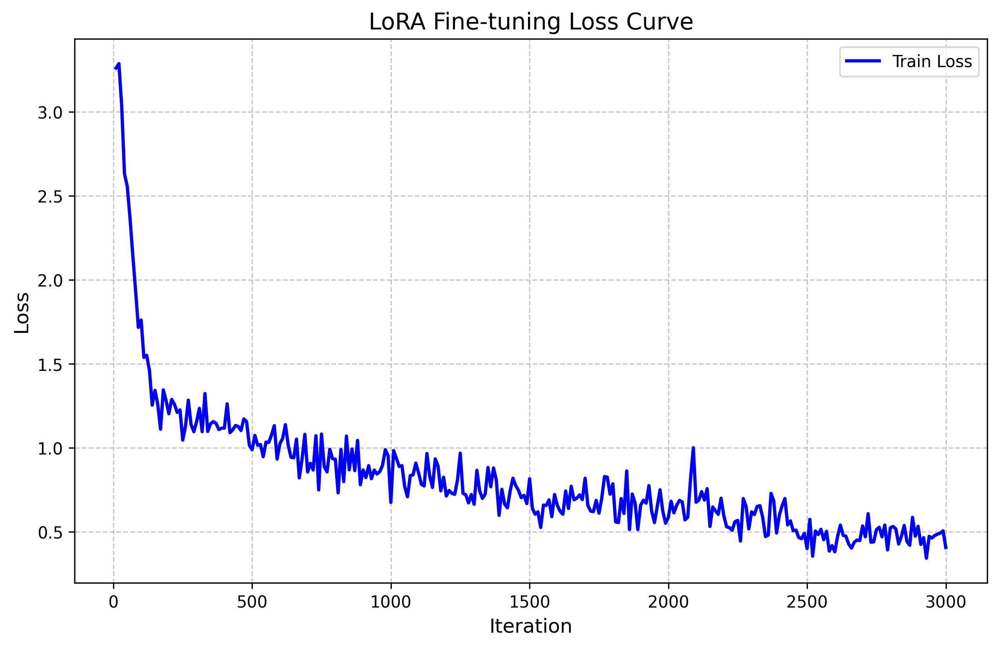

# Experiment B: 0.5B Model (Dataset Expansion & Hyperparameter Tuning)

## Objective
The primary goal of this experiment was to reach **>80% routing accuracy** using the highly efficient `Qwen2.5-0.5B-Instruct` model. To achieve this, we employed three key optimizations:
1. **Dataset Expansion**: The dataset was completely rebuilt in English-only and expanded to ~2.4k training samples using subsets from `BFCL_v3` (Berkeley Function Calling Leaderboard). The dataset format was upgraded to standard ChatML format (`messages` array).
2. **Gradient Accumulation**: Set to `4`, ensuring a more stable gradient estimation without hitting GPU VRAM constraints on MLX.
3. **Advanced Learning Rate Scheduler**: Implemented a cosine decay schedule with 300 warm-up steps across 3000 total iterations (approx. 5 epochs), allowing the model to safely converge without overshooting the optimal weights.

## Evaluation Results

We ran inference across the test dataset of 304 samples. The router was strictly evaluated on its capability to pick the exact tool (or abstain correctly with `Z`) for zero-shot function calling. 

| Metric | Base Model | LoRA Finetuned Model |
|--------|------------|----------------------|
| **Accuracy** | 46.71% | **86.51%** |
| **Correct Predictions** | 142 / 304 | **263 / 304** |
| **Total Inference Time** | 44.37s | 50.36s |
| **Average Latency** | ~146 ms / prompt | ~166 ms / prompt |

**Absolute Improvement**: +39.80%

We successfully met and exceeded the 80% accuracy threshold! The 0.5B parameter router operates blazingly fast (under 170ms per prompt) and performs complex tool routing highly effectively.

## Loss Curve Analysis

Below is the training loss and validation loss over the 3000 iterations:

*Note: The cosine decay schedule softly guided the learning rate, minimizing noisy gradients while steadily decreasing the loss to below 0.40.*

## Next Steps
With the 0.5B model reaching 86.51% accuracy, we have a highly capable "Small & Fast" intelligent router. Based on Phase 5 of our roadmap, we can now consider:
- **Model Scaling**: Training slightly larger models (e.g. 1.5B or 3B parameters) to see if we can push accuracy into the mid-to-high 90s, while measuring the latency tradeoffs.
- **Real-world Validation**: Integrating this router into the broader AI system and validating its performance on unseen queries.
