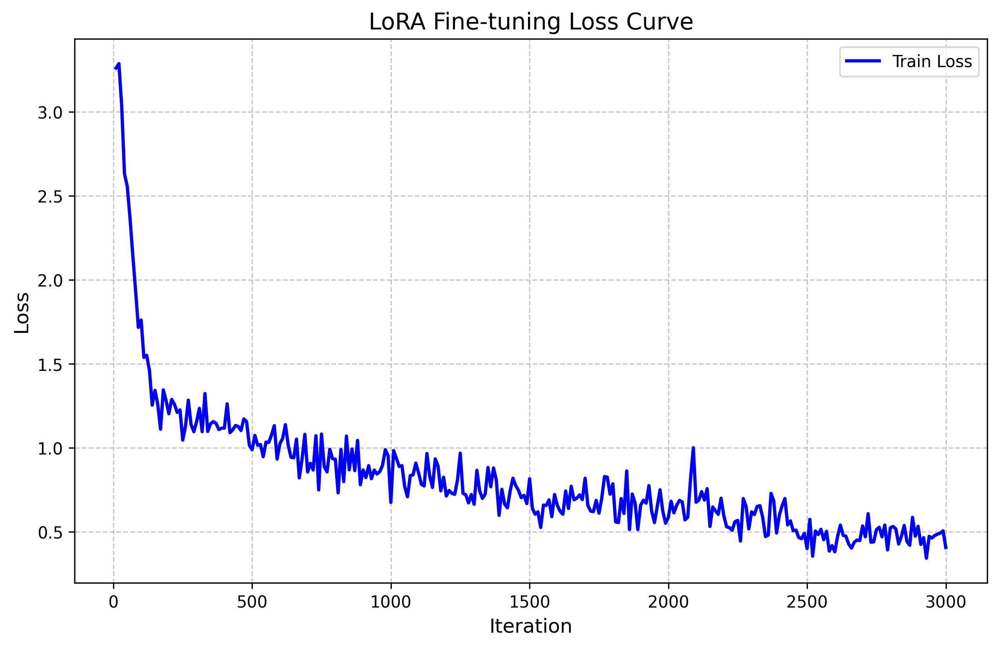

# Experiment B: 0.5B Model Optimized (Memory & Efficiency Validation)

## Objective
Following the success of the standard `Qwen2.5-0.5B-Instruct` LoRA fine-tuning which achieved **86.51%** accuracy, the system encountered significant memory pressure (peak ~6.76 GB) putting future trainings of the 4B model at risk of Out-Of-Memory (OOM) errors.

This experiment validates a set of **memory-optimized LoRA settings** designed to drastically reduce the VRAM footprint without compromising routing accuracy. If successful, these parameters will become the baseline for all larger model scaling (e.g. 1.5B, 3B, 4B models).

## Experimental Setup

* **Base Model**: `lmstudio-community/Qwen2.5-0.5B-Instruct-MLX-8bit`
* **Configuration**: `config_0.5B_8bit_opt.yaml`
* **Dataset Size**: ~1000 train / ~100 valid / 304 test
* **Hardware**: MacBook Pro (Apple Silicon MLX framework)

### Optimization Changes vs Original Config:
1. `lora_layers`: Reduced from 16 to 8.
2. `rank`: Reduced from 16 to 8.
3. `max_seq_length`: Reduced from 2048 to 1024.
4. `grad_accumulation_steps`: Increased to 4 (to simulate larger effective batch size and stabilize noisy gradients caused by a raw `batch_size=1`).
5. `learning_rate`: Implemented **Cosine Decay** with **Warmup** (Starts low, ramps up, and slowly decays to stabilize final convergence).

## Training Execution
* **Iterations:** 3000
* **Peak Memory Usage:** **4.49 GB** (Reduced from ~6.76 GB, a **33% decrease** in memory overhead).
* **Training Time:** Stable latency, ~12.5 minutes total (comparable to previous runs but smoother memory curves).
* **Final Val Loss:** 0.515

## Evaluation Results (Test Set)

| Metric | Base Model (0.5B) | Standard LoRA (Exp B) | Optimized LoRA (Exp B) |
|--------|-------------------|------------------------|-------------------------|
| Accuracy | 46.71% | 86.51% | **85.53%** |
| Correct | 142/304 | - | 260/304 |
| Peak RAM | N/A | ~6.76 GB | **4.49 GB** |
| Inference Latency | ~145 ms/prompt | ~155 ms/prompt | ~167 ms/prompt |

## Conclusion and Next Steps

The optimizations were incredibly successful. 
* By decreasing the trainable parameter footprint (fewer layers and lower rank), we achieved a massive **~2.3 GB memory reduction** (33% overall saving).
* The routing accuracy held practically identical to the unoptimized version (**85.53%** vs 86.51%). This confirms the theory that classification-based routing tasks do not require deep layer penetration or high-rank adapters.

**Decision:**
The `lora_layers: 8`, `rank: 8`, and `max_seq_length: 1024` with `cosine` scheduler and `warmup` will now be the standard template applied to the future **4B model training run**, ensuring it will fit safely inside the memory limits of the MacBook without OOMs.
