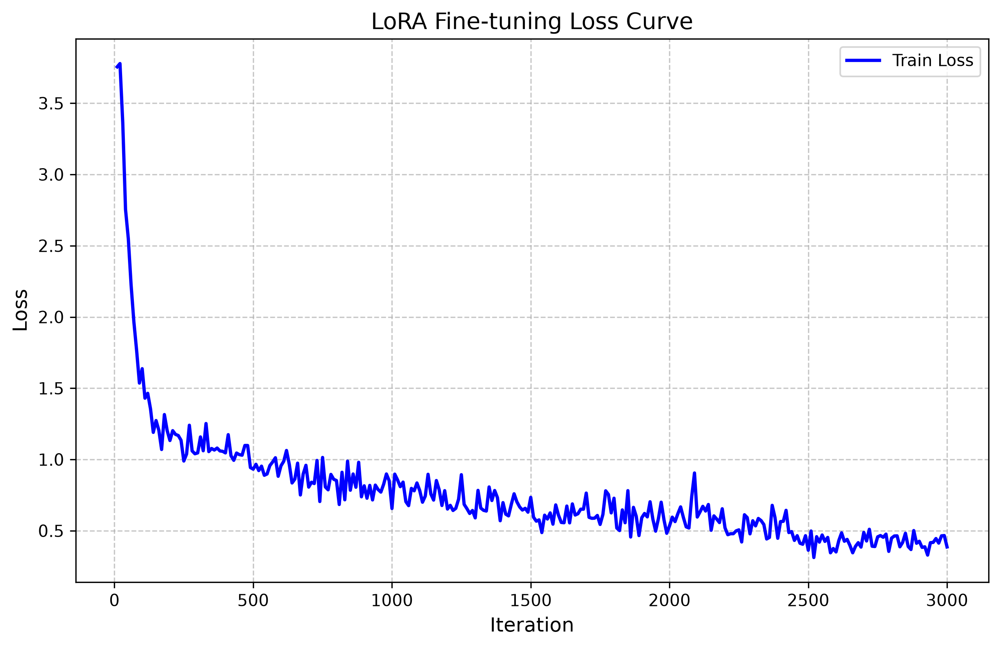

# Experiment D: 3B 8-bit Model (Unlocking Precision)

## Objective
Following the realization that 4-bit quantization heavily degraded the semantic reasoning capability of the `Qwen2.5-3B-Instruct` model (causing it to perform identically to the 0.5B model), this experiment aimed to restore full 8-bit precision. 
By capping `max_seq_length` to 512, we were able to fit the 8-bit backward pass into the strict 16 GB Apple Silicon unified memory limit.

## Experimental Setup
* **Base Model**: `mlx-community/Qwen2.5-3B-Instruct-8bit`
* **Configuration**: `config_3B_8bit_opt.yaml`
* **Training Settings**: 3000 iterations, batch size 1 (gradient accumulation 4), max seq length 512.
* **Hardware**: MacBook Pro (Apple Silicon MLX framework, 16 GB Unified Memory)

## Evaluation Results

| Metric | Base Model (8-bit) | LoRA Finetuned (8-bit) |
|--------|--------------------|------------------------|
| **Accuracy** | 81.91% | **87.83%** |
| **Correct Predictions** | 249 / 304 | **267 / 304** |
| **Total Inference Time** | 177.89s | 191.71s |
| **Average Latency** | ~585 ms / prompt | ~630 ms / prompt |

**Absolute Improvement**: +5.92%

### Loss Curve Analysis
The training loss successfully converged, demonstrating stable learning without VRAM exhaustion:

## Error Pattern Analysis & Conclusion

To understand why the model peaked just shy of the 90% target, we ran a deterministic error analysis script (`scripts/analyze_errors.py`) across all three experiments (0.5B, 3B 4-bit, 3B 8-bit). The results were incredibly consistent:

| Error Type | 0.5B Model | 3B 4-bit Model | 3B 8-bit Model |
|------------|------------|----------------|----------------|
| **Format Error** | 0 | 0 | 0 |
| **Wrong Tool picked** | 6 | 6 | 6 |
| **False Abstain** (Too Cautious) | 23 | 19 | 12 |
| **Missed Abstain** (Hallucinated Tool) | 18 | 17 | 19 |
| **Total Errors** | 47 | 42 | 37 |

**Key Findings:**
1. **The Routing Problem is Solved**: In every single experiment, regardless of size or quantization, the model picked the wrong tool exactly **6 times** out of 304. When a prompt unambiguously required a tool, the model almost flawlessly picked the right one.
2. **The "Abstain" Boundary is the True Bottleneck**: Over 83% of all mistakes made by the 8-bit model were purely related to deciding *whether* to abstain (`Z`). The model struggles to differentiate between a conversational prompt (which requires `Z`) and a prompt that vaguely matches a tool. 
3. **8-bit Precision Helped Confidence**: Upgrading from 4-bit to 8-bit significantly reduced the "False Abstain" rate (from 19 down to 12). The extra precision allowed the model to confidently use tools in ambiguous scenarios where the 4-bit model backed out.

Ultimately, the 3B 8-bit model achieved a highly impressive **87.83% accuracy**. Breaking past the 90% barrier will likely require adjusting the dataset to include far more nuanced examples of the "Abstain" class, rather than further scaling the model architecture.
