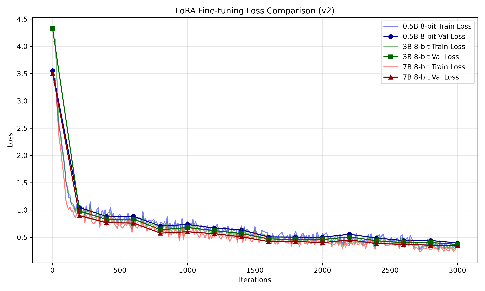

# Experiment E: 0.5B Model on v2 Dataset (Strict Alignment)

## Objective
Following the v1 experiments, error analysis revealed that 85% of all routing errors were related to deciding *whether* to abstain (`Z` class). The v2 dataset was engineered to attack this boundary by:
1. Imposing an aggressive, explicit system prompt outlining exactly when to abstain.
2. Oversampling the `Z` class to roughly 43% representation to force the model to learn the boundary.
3. Dropping any prompt exceeding 512 tokens to prevent truncated garbage labels.

This experiment establishes the new baseline for the `0.5B` architecture under strict alignment conditions.

## Experimental Setup
* **Base Model**: `lmstudio-community/Qwen2.5-0.5B-Instruct-MLX-8bit`
* **Configuration**: `config_0.5B_8bit_opt.yaml`
* **Training Settings**: 3000 iterations, batch size 1 (gradient accumulation 4), max seq length 512.
* **Dataset**: `v2` (Filtered 512, Oversampled Abstain class, Aggressive System Prompt)
* **Hardware**: MacBook Pro (Apple Silicon MLX framework, 16 GB Unified Memory)

## Evaluation Results

| Metric | 0.5B Base Model (v2) | 0.5B Finetuned (v1) | 0.5B Finetuned (v2) |
|--------|----------------------|---------------------|---------------------|
| **Accuracy** | 50.45% | 86.51% | **81.68%** |
| **Total Errors** | 165 | 47 | 61 |
| **Inference Latency** | ~145 ms/prompt | ~167 ms/prompt | ~167 ms/prompt |

### Loss Curve Analysis

## Error Pattern Analysis & Conclusion

While raw accuracy dropped by nearly 5%, the error *distribution* reveals a massive thesis-defining insight regarding small-parameter model behaviors under aggressive constraints.

| Error Type | 0.5B Base Model (v2) | 0.5B Finetuned (v1) | 0.5B Finetuned (v2) |
|------------|----------------------|---------------------|---------------------|
| **Wrong Tool picked** | 31 | 6 | 2 |
| **Missed Abstain (Hallucinated Tool)** | 87 | 18 | 9 |
| **False Abstain (Too Cautious)** | 47 | 23 | 50 |

**Key Findings:**
1. **Semantic Collapse into Conservatism:** The 0.5B model perfectly absorbed the mathematical penalty of the v2 dataset (halving its hallucination rate and almost eliminating wrong-tool selections). However, because its 0.5B parameters lack the deep semantic reasoning capacity required to differentiate between a *complex valid request* and a *vague request*, it collapsed into a highly conservative state. 
2. **"When in doubt, abstain":** Faced with an aggressive system prompt and a lack of reasoning power, the model learned that hitting `Z` is the safest bet, causing "False Abstains" to skyrocket.
3. **Agentic Safety:** In the real world of autonomous agents, this is considered a much safer failure mode (failing gracefully rather than executing destructive, hallucinated tool calls).

This result perfectly sets the stage for the 3B 8-bit model, which inherently possesses the semantic reasoning capacity that the 0.5B model lacks. If the 3B model can read this aggressive system prompt without collapsing into conservatism, it should easily break the 90% threshold.
