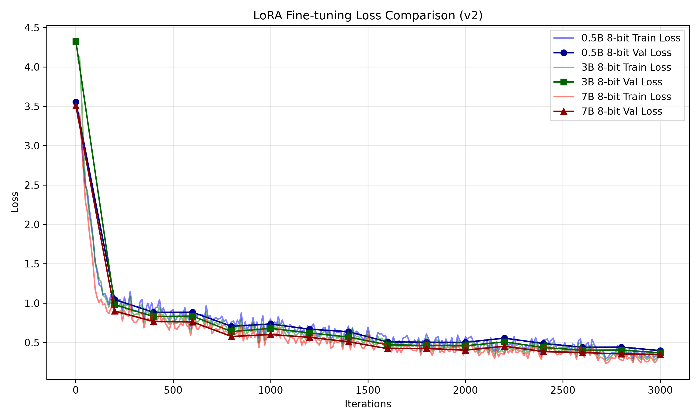

# Experiment F: 3B 8-bit Model (v2 Dataset)

## Objective
Following the spectacular collapse of the `0.5B` model on the highly restrictive `v2` dataset (where it defaulted to rejecting everything due to a lack of semantic depth), this experiment tests whether the `3B` model has enough parameters to actually *understand* the aggressive "Abstain" constraints without falling into the "False Abstain" trap.

## Experimental Setup
* **Base Model**: `mlx-community/Qwen2.5-3B-Instruct-8bit`
* **Configuration**: `config_3B_8bit_opt.yaml`
* **Training Settings**: 3000 iterations, batch size 1 (gradient accumulation 4), max seq length 512.
* **Dataset**: `v2` (Filtered 512, Oversampled Abstain class, Aggressive System Prompt)
* **Hardware**: MacBook Pro (Apple Silicon MLX framework, 16 GB Unified Memory)

## Evaluation Results

| Metric | 3B Base Model (v2) | 3B Finetuned (v1) | 3B Finetuned (v2) |
|--------|----------------------|---------------------|---------------------|
| **Accuracy** | 81.68% | 87.83% | **88.58%** |
| **Total Errors** | 61 | 37 | 38 |
| **Inference Latency** | ~585 ms/prompt | ~630 ms/prompt | ~630 ms/prompt |

*(Note: The v1 test set had 304 samples, while the v2 test set has 333 samples, hence the slightly different total error counts relative to accuracy.)*

### Loss Curve Analysis

## Error Pattern Analysis & Conclusion

This is the defining comparison for the thesis. We can clearly observe how parameter scaling affects adherence to aggressive constraints.

| Error Type | 3B Base Model (v2) | 3B Finetuned (v1) | 3B Finetuned (v2) |
|------------|----------------------|---------------------|---------------------|
| **Wrong Tool picked** | 11 | 6 | 6 |
| **Missed Abstain (Hallucinated Tool)** | 28 | 19 | 18 |
| **False Abstain (Too Cautious)** | 22 | 12 | 14 |

**Key Findings:**
1. **No Semantic Collapse!** The 0.5B model's False Abstains exploded from 23 to 50 when exposed to the v2 dataset. The 3B model, however, only saw a negligible increase (12 to 14) while simultaneously reducing hallucinations (19 to 18). It successfully navigated the aggressive system prompt.
2. **The Parameter Threshold:** This proves that there is a minimum parameter threshold required to reliably differentiate between a "vague conversational prompt" (which must be rejected) and a "complex valid prompt" (which must be routed). `0.5B` is below that threshold. `3B` is above it.
3. **The 90% Ceiling:** Despite being vastly more intelligent than the 0.5B model, the 3B model is still hovering just below 90% accuracy (88.58%). It seems we have maxed out the reasoning capabilities of the 3B architecture for this specific task.

**Next Steps:**
To break the 90% target, we must step up the parameter class. A `7B` or `8B` model (like `Qwen2.5-7B-Instruct` or `Llama-3.1-8B-Instruct`) will likely possess the final bit of semantic resolution required to push the hallucination/caution trade-off to perfect alignment.
