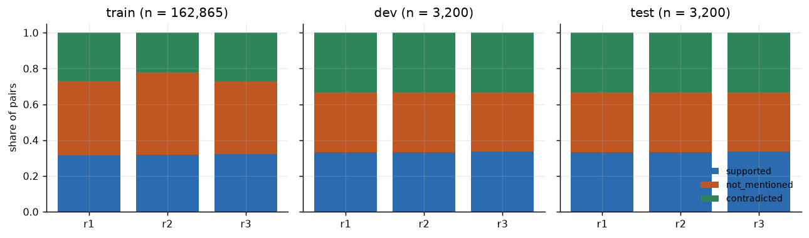
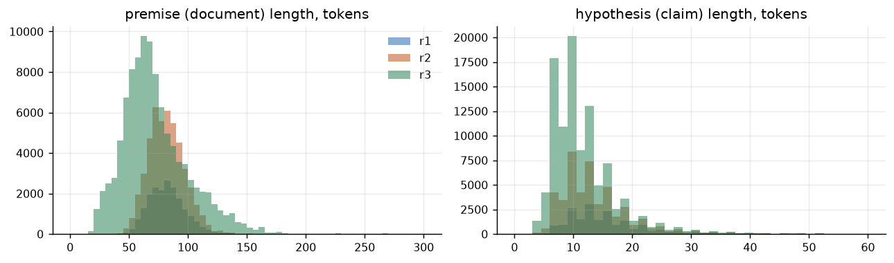
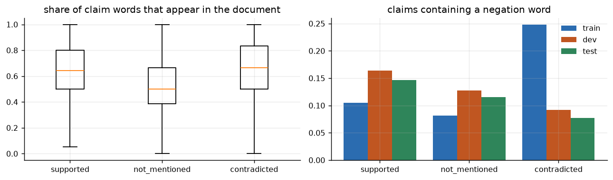
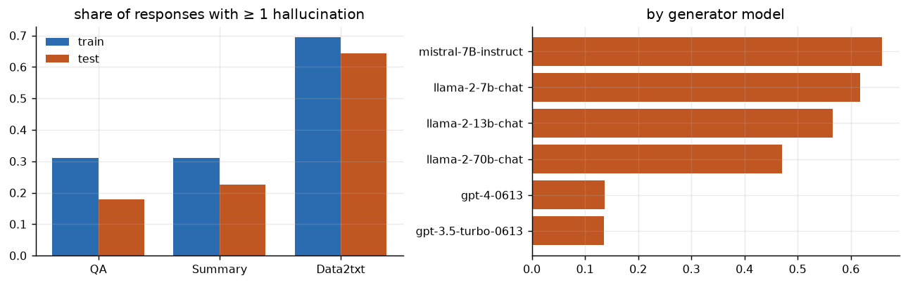
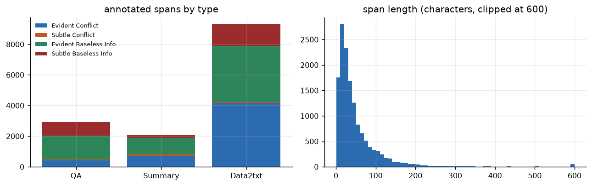
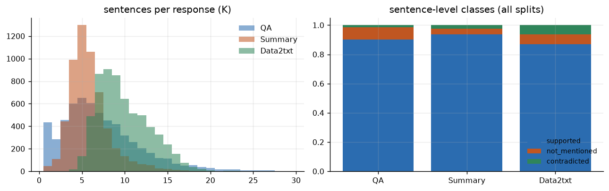
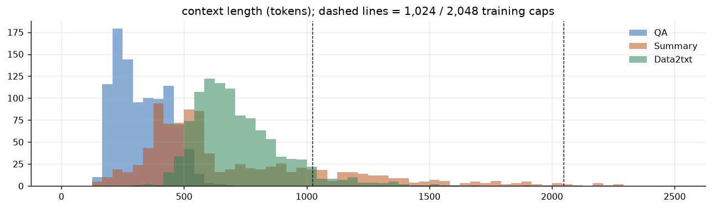
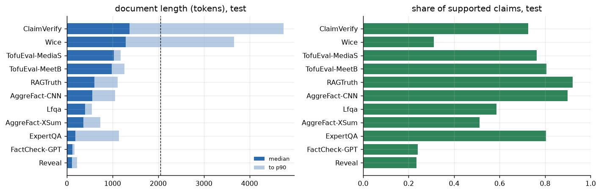
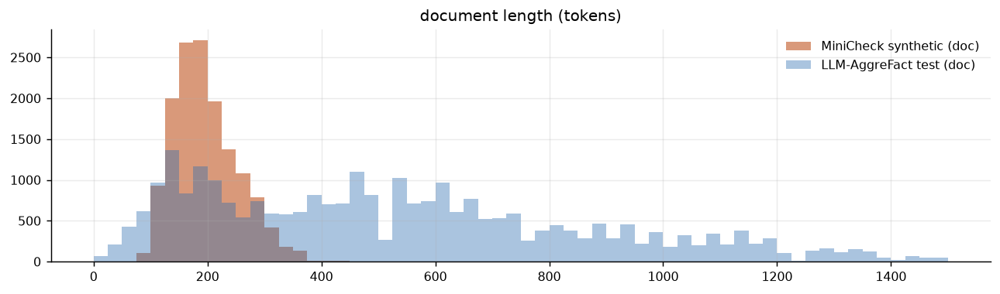
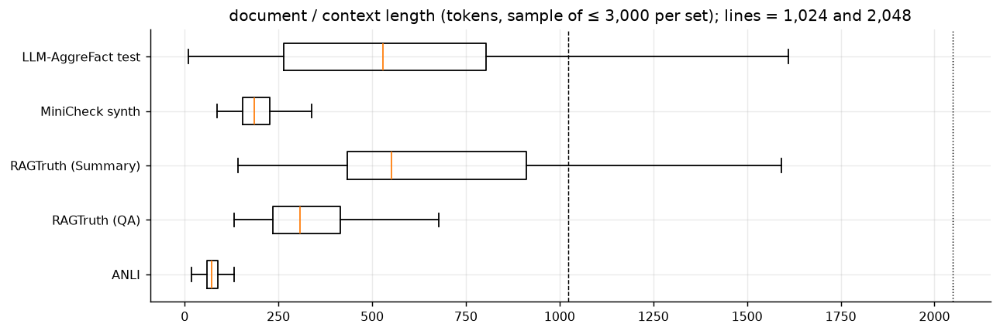

# EDA report: datasets for GroundOne (Phase 1a)

Generated 2026-10-05 11:33 by `EDA/scripts/make_report.py`. Scripts: `EDA/scripts/01_anli.py`, `02_ragtruth.py`, `03_minicheck_aggrefact.py`, `04_cross.py`. Raw numbers: `EDA/report/stats/`. Data: `Project/data/raw/` (see `Project/data/manifest.json`).

## 0. Experiments the data must serve

| ID | Experiment |
| --- | --- |
| X1 | Binary groundedness: training data (specialisation, RQ1) |
| X2 | Binary groundedness: evaluation comparable with published results (RQ1, RQ5 plain task) |
| X3 | K decisions over one shared context: latency and parallel scoring (RQ2) |
| X4 | Three-way question: supported / contradicted / not mentioned (RQ5) |
| X5 | Rules in the prompt: strict vs lenient definition of an error (RQ5) |
| X6 | Calibration: dev split for temperature, test split for ECE / selective prediction (RQ3) |
| X7 | Demo realism: RAG answers to user questions over retrieved passages |

## 1. Summary

Four datasets were analysed: **ANLI** and **RAGTruth** in depth, **MiniCheck synthetic data** and **LLM-AggreFact** more briefly. The question was which dataset can serve which experiment of the thesis (X1–X7 below). Main findings:

1. **No single dataset covers everything.** ANLI is the only source with balanced, human three-way labels (supported / contradicted / not mentioned), so it carries the three-way question and the rules. RAGTruth is the only source of real multi-sentence RAG answers over a shared context, so it carries the K-decisions experiment and in-domain training. LLM-AggreFact is the benchmark that makes our numbers comparable with published ones.
2. **The LLM-AggreFact "RAGTruth" subset is RAGTruth itself.** Its dev part consists of sentences from the RAGTruth *train* split (14,046 of 15,340 matched) and its test part of sentences from the RAGTruth *test* split (14,942 of 16,371). Training on RAGTruth train is therefore safe for the LLM-AggreFact **test** set. LLM-AggreFact itself may only be used for evaluation (licence / gating condition), so none of its splits is used for calibration or model selection. RAGTruth test and LLM-AggreFact-RAGTruth test are the same data and must not be counted twice.
3. **Our sentence labels for RAGTruth are reliable.** On 29,191 sentences matched with LLM-AggreFact's own labels, our span-derived binary label agrees in **98.6 %** of cases. All 419 disagreements go the same way: we say "unsupported", LLM-AggreFact says "supported". They are not explained by the `implicit_true` / `due_to_null` flags; the likely cause is a different overlap rule or segmentation. We use LLM-AggreFact's labels for binary evaluation (comparability) and our labels where only we have them (three-way classes).
4. **Contradictions are rare in RAG answers, except in Data2txt.** At sentence level RAGTruth train has 105,572 supported, 8,077 not-mentioned and 4,658 contradicted sentences, and 77 % of the contradiction spans come from Data2txt (Yelp records as JSON). In the QA test split only 0.5 % of sentences are contradicted. A three-way test on RAGTruth QA alone would be meaningless; ANLI is needed.
5. **ANLI reuses documents across splits.** Each premise has ~16 hypotheses on average, and 98.6 % (dev) / 98.9 % (test) of the dev/test premises also occur in train with other hypotheses. For a clean test of whether rules generalise, the ANLI training subset should exclude those premises: **93,480 train pairs remain** (24,455 contradiction, 38,604 neutral, 30,421 entailment), far more than needed.
6. **ANLI has a shortcut in train that is reversed in dev/test.** In the train split 25 % of contradiction hypotheses contain a negation word, against 8–11 % for the other classes. In dev and test the pattern is reversed: contradictions contain *fewer* negations (8–9 %) than supported claims (15–16 %), a consequence of ANLI's adversarial collection. A model that learns "negation → contradicted" from train is penalised on dev/test. Not-mentioned claims also share fewer words with the premise (median overlap 0.50 vs 0.64–0.67). Phase 1 should run a claim-only baseline and, if needed, rebalance negations in the training subset.
7. **Lengths and the training cap.** Median document length: ANLI 73 tokens, MiniCheck 186, RAGTruth QA 308, RAGTruth Summary 552, LLM-AggreFact test 530 (but ClaimVerify and Wice reach a p90 of 3,600–4,700 tokens). For RAGTruth, 22 % of full prompts (context + answer) exceed 1,024 tokens and only 1 % exceed 2,048. **A 2,048-token cap keeps 99 % of RAGTruth; 1,024 would drop a fifth of it**, mostly Summary and Data2txt.
8. **K is naturally high in RAGTruth.** Median sentences per answer: 9 (Data2txt), 6 (QA), 5 (Summary); 45 % of answers have K ≥ 8. With three questions per sentence, K = 15–27 per answer is realistic, exactly the regime where Phase 0b measured a 2–6× gain.
9. **RAGTruth is clean between its splits** (no source document is in both train and test) and has 173 responses flagged as `incorrect_refusal` or `truncated` that should be dropped.
10. **No overlap** was found between MiniCheck synthetic data or ANLI and LLM-AggreFact (documents or claims).

## 2. Usability of each dataset per experiment

✅ suitable · ⚠️ usable with care · ❌ not suitable

| Experiment | ANLI | RAGTruth | MiniCheck synthetic | LLM-AggreFact |
| --- | --- | --- | --- | --- |
| **X1** Binary groundedness, training (RQ1) | ✅ the MiniCheck "hard ANLI" subset; filter premises seen in dev/test; the train-only negation shortcut must be checked | ✅ in-domain; sentence level; ~90 % supported, so rebalance; drop refusals/truncated | ✅ the core of the MiniCheck recipe (14,395 pairs); makes the comparison with MiniCheck data-matched | ❌ evaluation only (its dev RAGTruth part *is* RAGTruth train) |
| **X2** Binary evaluation comparable with published results (RQ1, plain task of RQ5) | ⚠️ dev/test usable as a secondary, non-RAG check | ✅ test split, but it **is** the LLM-AggreFact-RAGTruth test; report once, with LLM-AggreFact labels | ❌ training data | ✅ **primary benchmark** (test, 11 sub-datasets, macro balanced accuracy, threshold 0.5); long documents in ClaimVerify/Wice need the 2,048 cap or chunking, stated |
| **X3** K decisions over one shared context (RQ2) | ⚠️ several hypotheses per premise give a synthetic K, but contexts are tiny (~75 tokens) | ✅ **the natural set**: real answers, median K 5–9, contexts 300–700 tokens | ❌ ~2 claims per document | ⚠️ only its RAGTruth part has several claims per document (same data as RAGTruth) |
| **X4** Three-way question (RQ5) | ✅ **primary**: human three-way labels, balanced dev/test (1/3 each) | ⚠️ train usable (8,077 not mentioned, 4,658 contradicted, mostly Data2txt); test too skewed (602 contradicted, almost none in QA); report per task | ❌ binary only | ❌ binary only |
| **X5** Rules in the prompt, strict vs lenient (RQ5) | ✅ **primary**: rule labels derived from three-way labels, balanced, so the two rules differ on ~1/3 of items | ⚠️ the rules differ only on not-mentioned sentences (~4–7 %); informative mainly on Data2txt; the `implicit_true` flag (2,012 sentences) allows a third rule ("true world knowledge is acceptable") | ❌ | ❌ |
| **X6** Calibration: dev for temperature, test for ECE (RQ3) | ✅ dev for temperature (three-way and rules), test for evaluation | ✅ dev carved from train **by source_id** (no source crosses splits) | ⚠️ could provide a dev slice, but synthetic | ❌ **evaluation only by licence** (no fitting of temperature or thresholds on it; its RAGTruth dev part is also RAGTruth train) |
| **X7** Demo realism (local RAG) | ❌ single sentences, Wikipedia | ✅ **QA** (MS MARCO questions, 3 retrieved passages, ~300 tokens) is closest to the demo; Summary acceptable; Data2txt (JSON) unlike the demo | ❌ | ❌ |

## 3. Recommendations for Phase 1 (data)

1. **Training mix (binary + three-way + rules), first proposal:**
   - MiniCheck synthetic, all 14,395 pairs (binary).
   - ANLI train, the ~21K MiniCheck hard subset, restricted to premises **not** in ANLI dev/test (three-way labels kept, so the same pairs also feed the three-way question and the rules).
   - RAGTruth train, sentence level, quality = good, rebalanced (e.g. all not-mentioned and contradicted sentences plus an equal number of supported ones), each answer used as a shared context so that training matches the K-question inference format.
   - Size to be fixed against the training budget: ≈35K for the 0.5B (≈ 3–4 h) and a ~10K subset for the 3B (one night).
2. **Length cap 2,048 tokens** (keeps 99 % of RAGTruth); log every excluded item.
3. **Splits:** RAGTruth dev carved from train by `source_id`; ANLI dev for temperature and threshold, ANLI test held out; LLM-AggreFact test held out; LLM-AggreFact is evaluation-only by licence (no training, no fitting on dev).
4. **Labels:** binary evaluation on RAGTruth with LLM-AggreFact's labels; our span-derived three-way labels for X4/X5, with the 98.6 % agreement reported.
5. **Checks to add to the build:** the leakage check (§5.3 of the plan) must also compare against LLM-AggreFact test claims; a claim-only baseline for the ANLI negation shortcut (present in train, reversed in dev/test).
6. **Report per RAGTruth task** (QA / Summary / Data2txt): they differ in format (JSON vs text), hallucination rate (18 % vs 64 % of test answers) and contradiction rate.

## 4. Limitations of this EDA

- Sentence splitting is rule-based (the Phase 0 splitter); 6 % of RAGTruth spans cross a sentence boundary and are assigned to every sentence they touch.
- Token counts use the Qwen2.5 tokenizer without the chat template (~60 extra tokens per prompt).
- Context-vs-source matching for LLM-AggreFact documents found only 27 % exact matches with RAGTruth sources (formatting differs); the overlap conclusion relies on claim (sentence) matching, which is exact for 92 % of the subset.

---

## 5. ANLI in detail

| split | r1 | r2 | r3 |
| --- | --- | --- | --- |
| train | 16946 | 45460 | 100459 |
| dev | 1000 | 1000 | 1200 |
| test | 1000 | 1000 | 1200 |

Premise tokens: median 74.0, p90 106.0, max 333.0. Hypothesis tokens: median 11.0, p90 20.0. Unique premises: 10,761 (15.73 hypotheses each on average); dev/test premises also in train: {'dev': 0.9862, 'test': 0.9888}. Negation rate by class: {'contradicted': 0.24, 'not_mentioned': 0.082, 'supported': 0.107}. Word overlap claim→document by class: {'contradicted': 0.643, 'not_mentioned': 0.523, 'supported': 0.634}. Annotator reason available for 16% of pairs.

Examples (dev):

- **supported**: premise "Franco Zeffirelli, KBE Grande Ufficiale OMRI (] ; born 12 February 1923) is an Italian director and producer of operas, films and television. He is also a forme…" / claim "Franco Zeffirelli had a political career"
- **not_mentioned**: premise "Almost Sunrise is a 2016 American documentary film directed by Michael Collins. It recounts the story of two Iraq veterans, Tom Voss and Anthony Anderson, who, …" / claim "Tom and Anthony have both killed someone."
- **contradicted**: premise "Linguistics is the scientific study of language, and involves an analysis of language form, language meaning, and language in context. The earliest activities i…" / claim "Form and meaning are the only aspects of language linguistics is concerned with."

*ANLI label shares per split and round. Train is imbalanced (neutral-heavy in R2/R3); dev and test are balanced.*

*ANLI premise and hypothesis lengths (Qwen2.5 tokens). Premises are single paragraphs; far shorter than RAG contexts.*

*Possible shortcuts in ANLI: word overlap and negation words differ by label. A model could partly learn the label from the claim alone.*

---

## 6. RAGTruth in detail

| task | train | test | hallucinated (train) | hallucinated (test) | context tokens p50 / p90 | K p50 / p90 |
| --- | --- | --- | --- | --- | --- | --- |
| QA | 5034 | 900 | 0.311 | 0.178 | 308.0 / 475.0 | 6.0 / 13.0 |
| Summary | 4758 | 900 | 0.311 | 0.227 | 552.0 / 1297.0 | 5.0 / 9.0 |
| Data2txt | 5298 | 900 | 0.694 | 0.643 | 685.0 / 965.0 | 9.0 / 14.0 |

Spans: 14,289 ({'Evident Baseless Info': 6237, 'Evident Conflict': 5324, 'Subtle Baseless Info': 2527, 'Subtle Conflict': 201}); flags {'implicit_true': 1928, 'due_to_null': 1642}; 6.1% cross a sentence boundary. Sentences: 138,239; train {'supported': 105572, 'not_mentioned': 8077, 'contradicted': 4658}; test {'supported': 18331, 'not_mentioned': 999, 'contradicted': 602}. Hallucination rate by generator: {'gpt-3.5-turbo-0613': 0.135, 'gpt-4-0613': 0.137, 'llama-2-70b-chat': 0.47, 'llama-2-13b-chat': 0.566, 'llama-2-7b-chat': 0.618, 'mistral-7B-instruct': 0.659}. Quality flags: {'good': 17617, 'incorrect_refusal': 144, 'truncated': 29}. Prompts over 1,024 tokens: 22%; over 2,048: 1%.

Data2txt context example: `{"name": "Apna Indian Kitchen", "address": "718 State St", "city": "Santa Barbara", "state": "CA", "categories": "Gluten-Free, Gastropubs, Vegan, Restaurants, Indian", "hours": {"Tuesday": "16:30-21:0", "Wednesday": "16:30-21:0", "Thursday": "16:30-21:0", "Friday": "16:30-21:0", "Saturday": "16:30-2…`

*RAGTruth responses with at least one annotated hallucination, by task and by the LLM that wrote them.*

*RAGTruth hallucination spans: Baseless Info (content not in the context) dominates; Conflict (contradiction) is rarer, and Subtle Conflict is very rare.*

*RAGTruth at sentence level (labels derived from spans): K per response and the share of supported / not mentioned / contradicted sentences.*

*RAGTruth context lengths by task. Data2txt contexts are JSON business records; QA contexts are 3 retrieved passages.*

---

## 7. MiniCheck synthetic data and LLM-AggreFact

MiniCheck synthetic: {'d2c': 7319, 'c2d': 7076}, supported rate {'c2d': 0.58, 'd2c': 0.35}, document tokens median 188.0 (p90 276.0), claim tokens median 17.0, 2.34 claims per document.

| dataset | n | supported | doc_tok_p50 | doc_tok_p90 | claim_tok_p50 |
| --- | --- | --- | --- | --- | --- |
| AggreFact-CNN | 558 | 0.898 | 560.0 | 1058.9 | 67.0 |
| AggreFact-XSum | 558 | 0.511 | 359.0 | 728.6 | 27.0 |
| ClaimVerify | 1088 | 0.725 | 1368.0 | 4743.4 | 23.0 |
| ExpertQA | 3702 | 0.803 | 185.0 | 1137.6 | 30.0 |
| FactCheck-GPT | 1566 | 0.24 | 117.0 | 168.5 | 14.0 |
| Lfqa | 1911 | 0.587 | 401.0 | 547.0 | 25.0 |
| RAGTruth | 16371 | 0.922 | 606.0 | 1110.0 | 23.0 |
| Reveal | 1710 | 0.234 | 112.0 | 223.0 | 13.0 |
| TofuEval-MediaS | 726 | 0.763 | 1025.0 | 1178.0 | 22.0 |
| TofuEval-MeetB | 772 | 0.806 | 981.0 | 1264.0 | 23.0 |
| Wice | 358 | 0.31 | 1286.0 | 3657.5 | 31.5 |

LLM-AggreFact test documents over 2,048 tokens: 2.4%.

*LLM-AggreFact sub-datasets: document length and label balance vary widely; balanced accuracy averages them with equal weight.*

*MiniCheck training documents are short (median ≈ 190 tokens; ≈ 290 with claim and prompt) compared with many LLM-AggreFact documents.*

---

## 8. Cross-dataset checks

- LLM-AggreFact RAGTruth subset: 31,711 claims, {'test': 16371, 'dev': 15340}; matched to RAGTruth sentences by split: {'test': 14942, 'train': 14046, 'nan': 2364, 'test/train': 359}.

- Label agreement (our span-derived binary label vs LLM-AggreFact): 98.6% on 29,191 sentences; cross-tab (rows ours, columns LLM-AggreFact; 1 = supported): {'0': {'0': 2518, '1': 419}, '1': {'0': 1, '1': 26253}}.

- Overlap with LLM-AggreFact: MiniCheck documents 0, MiniCheck claims 0, ANLI premises 0.

- Median document tokens: {'ANLI': 73.0, 'RAGTruth (QA)': 308.0, 'RAGTruth (Summary)': 552.0, 'MiniCheck synth': 186.0, 'LLM-AggreFact test': 530.0}.

*Document length across all datasets. ANLI premises are an order of magnitude shorter than RAG contexts.*

---

## 9. Label schemes

- **ANLI**: 3 classes from humans: entailment / neutral / contradiction
- **RAGTruth**: character spans of 4 types on LLM answers; sentence classes derived (supported / not mentioned / contradicted)
- **MiniCheck synth**: binary supported / unsupported (synthetic, LLM-generated)
- **LLM-AggreFact**: binary supported / unsupported (human); partial support = unsupported
