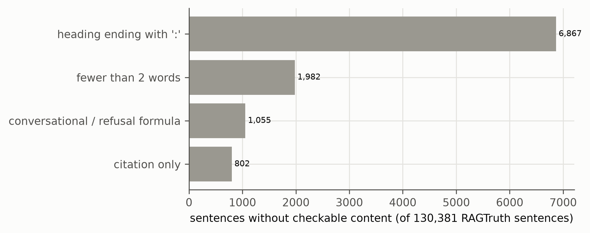
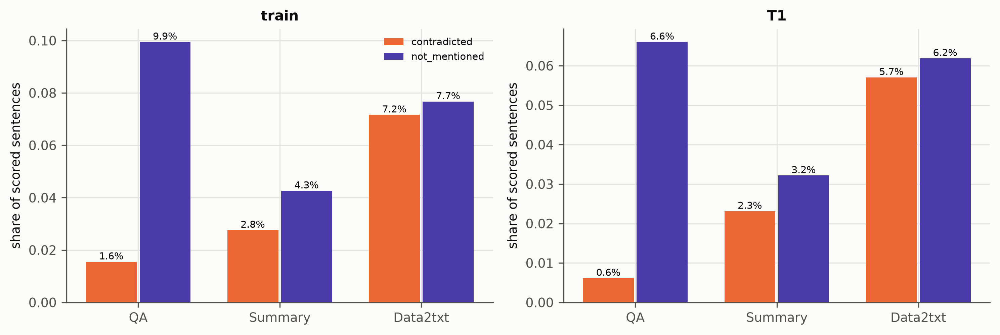
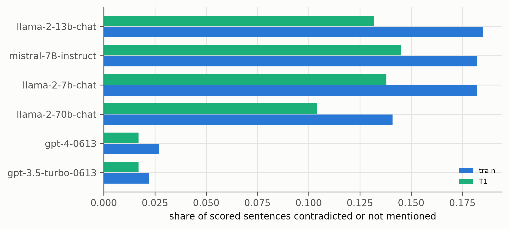

# EDA report: the GroundOne dataset and its sources

Generated 2026-10-06 22:45 by `EDA/scripts/make_report.py`. Scripts: `01_ragtruth.py`, `02_aggrefact.py`, `03_vitaminc.py` (part A, sources) and `04_dataset.py` (part B, built dataset). Raw numbers: `EDA/report/stats/`. Dataset specification: `Project/docs/dataset_plan.md`; counts: `Project/data/processed/groundone/DATACARD.md`.

## 1. Summary

The EDA has two parts:
- **Part A** describes the three source datasets of the GroundOne dataset: RAGTruth (training source and test T1), LLM-AggreFact (test T2) and VitaminC (test T3).
- **Part B** describes the dataset built from them (`Project/data/processed/groundone/`, counts in its `DATACARD.md`). It focuses on the properties that shape the experiments and their interpretation.

**Part A: sources**
- **RAGTruth hallucinations are concentrated by task and by generator.**
  - Data-to-text answers are hallucinated about 2–4 times as often as QA or summaries (share of answers with at least one span).
  - Llama-2 and Mistral answers carry most of them; GPT-3.5/4 answers are almost clean.
  - *Baseless* spans (→ not_mentioned) outnumber *Conflict* spans (→ contradicted), and *Subtle Conflict* is very rare (201 spans).
- **LLM-AggreFact sub-datasets differ widely** in document length (median 112–1,368 tokens) and label balance (23–92 % supported).
  - Its macro average weights them equally, although RAGTruth has 56 % of the claims.
  - 2.4 % of its documents exceed the 2,048-token cap and are chunked.
- **VitaminC real test claims are short** (median 18 tokens) and the evidence is one Wikipedia sentence (median 36 tokens).
  - Many claims are numerical: 59 % of supported, 71 % of refuted and 44 % of NEI claims contain a digit.
  - The classes are unbalanced in the release (50 / 29 / 21 %), hence the per-class sample in T3.

**Part B: built dataset**
- **Segmentation.** pysbd with line splitting gives 5 % fewer sentences than the earlier regex splitter (130,381 vs 137,428), mainly because it does not cut decimals.
  - 8.2 % of sentences have no checkable content and are kept as context only.
  - Most of these are headings that introduce a list (6,867); the rest are short fragments (1,982), conversational or refusal formulas (1,055) and citation-only lines (802).
- **Test answers are cleaner than training answers.** In every task, T1 has a lower share of contradicted and not-mentioned sentences than train (e.g. QA contradicted 0.6 % vs 1.6 %). This holds for every generator. Metrics that depend on the base rate (precision, F1 on the minority classes) are therefore not comparable between dev and T1; balanced accuracy and macro recall are.
- **Where the classes come from.**
  - 85 % of contradicted training sentences come from *Evident Conflict* spans alone; *Subtle Conflict* gives only 147.
  - Not-mentioned sentences are 71 % *Evident* and 28 % *Subtle Baseless Info*.
  - The contradicted class is therefore mostly blatant contradictions (wrong numbers, names, facts). Subtle contradictions are barely represented and cannot be evaluated separately.
- **Surface cues exist and must be reported as baselines.**
  - *Word overlap.* The share of a sentence's content words found in the document separates the classes in all three sets (supported 0.64 > contradicted 0.47 > not mentioned 0.40 in T1). On its own it reaches AUROC 0.74 for supported vs not on T1, and 0.70 on VitaminC.
  - *Sentence wording.* A sentence-only classifier reaches a three-way balanced accuracy of 0.66 on Data2txt (chance on QA and Summary). Its strongest not-mentioned cues are Yelp details the business record rarely contains: "100 reviews", "rating google", "wifi", "valet garage", "family owned".
  - A verifier's gain must be measured against these two baselines, per task.

## 2. Consequences for the experiments

1. **Report three baselines that never read the document as a whole:** the majority class, word overlap and sentence-only n-grams. They give the floor against which GroundOne's specialisation is measured, per task.
2. **Use base-rate-independent metrics** (balanced accuracy, macro recall, AUROC) as primary metrics, because the class shares differ between train/dev and T1.
3. **Report results per task and per generator group** (GPT vs open models). The hallucination rate depends strongly on both.
4. **Present the contradicted class as mostly "evident" contradictions.** Claims about subtle contradictions would need data RAGTruth does not provide.
5. **T3 tests the same contradicted vs not-mentioned distinction in a different domain** (Wikipedia, single sentences, many numbers). It is useful precisely because it shares the word-overlap cue but not RAGTruth's Data2txt templates.

## 3. Limitations of this EDA

- Sentence labels depend on the span-to-sentence rule and on the segmentation. Both are validated against LLM-AggreFact's independent labels (98.75 % binary agreement, `DATACARD.md`), but the type (conflict vs baseless) has no published agreement.
- RAGTruth's original labels likely under-mark hallucinations (a 2026 re-annotation of the test split reports 1.68× more hallucinated answers). All class shares above are lower bounds.
- Word overlap is a crude lexical measure (no stemming, no synonyms). It is used as a cue detector, not as a model.
- The test splits were analysed only descriptively. No choice about the data or the model was tuned on them.

---

# Part A: source datasets

## 4. RAGTruth (training source, test T1)

| task | answers train | answers test | hallucinated train | hallucinated test | context tokens p50 / p90 |
| --- | --- | --- | --- | --- | --- |
| QA | 5034 | 900 | 0.311 | 0.178 | 308.0 / 475.0 |
| Summary | 4758 | 900 | 0.311 | 0.227 | 552.0 / 1297.0 |
| Data2txt | 5298 | 900 | 0.694 | 0.643 | 685.0 / 965.0 |

Spans: 14,289 ({'Evident Baseless Info': 6237, 'Evident Conflict': 5324, 'Subtle Baseless Info': 2527, 'Subtle Conflict': 201}); flags {'implicit_true': 1928, 'due_to_null': 1642}. Hallucination rate by generator: {'gpt-3.5-turbo-0613': 0.135, 'gpt-4-0613': 0.137, 'llama-2-70b-chat': 0.47, 'llama-2-13b-chat': 0.566, 'llama-2-7b-chat': 0.618, 'mistral-7B-instruct': 0.659}. Quality flags: {'good': 17617, 'incorrect_refusal': 144, 'truncated': 29}. Prompts over 2,048 tokens: 1.0%.

Data2txt context example: `{"name": "Apna Indian Kitchen", "address": "718 State St", "city": "Santa Barbara", "state": "CA", "categories": "Gluten-Free, Gastropubs, Vegan, Restaurants, Indian", "hours": {"Tuesday": "16:30-21:0", "Wednesday": "16:30-21:0", "Thursday": "16:30-21:0", "Friday": "16:30-21:0", "Saturday": "16:30-2…`

*RAGTruth responses with at least one annotated hallucination, by task and by the LLM that wrote them.*

*RAGTruth hallucination spans: Baseless Info (content not in the context) dominates; Conflict (contradiction) is rarer, and Subtle Conflict is very rare.*

*RAGTruth context lengths by task. Data2txt contexts are JSON business records; QA contexts are 3 retrieved passages.*

---

## 5. LLM-AggreFact test (test T2)

| dataset | n | supported | docs | claims_per_doc | doc_tok_p50 | doc_tok_p90 | claim_tok_p50 |
| --- | --- | --- | --- | --- | --- | --- | --- |
| AggreFact-CNN | 558 | 0.898 | 384 | 1.45 | 560.0 | 1058.9 | 67.0 |
| AggreFact-XSum | 558 | 0.511 | 483 | 1.16 | 359.0 | 728.6 | 27.0 |
| ClaimVerify | 1088 | 0.725 | 697 | 1.56 | 1368.0 | 4743.4 | 23.0 |
| ExpertQA | 3702 | 0.803 | 3135 | 1.18 | 185.0 | 1137.6 | 30.0 |
| FactCheck-GPT | 1566 | 0.24 | 1199 | 1.31 | 117.0 | 168.5 | 14.0 |
| Lfqa | 1911 | 0.587 | 100 | 19.11 | 401.0 | 547.0 | 25.0 |
| RAGTruth | 16371 | 0.922 | 450 | 36.38 | 606.0 | 1110.0 | 23.0 |
| Reveal | 1710 | 0.234 | 1498 | 1.14 | 112.0 | 223.0 | 13.0 |
| TofuEval-MediaS | 726 | 0.763 | 15 | 48.4 | 1025.0 | 1178.0 | 22.0 |
| TofuEval-MeetB | 772 | 0.806 | 15 | 51.47 | 981.0 | 1264.0 | 23.0 |
| Wice | 358 | 0.31 | 355 | 1.01 | 1286.0 | 3657.5 | 31.5 |

29,320 claims, 77.9% supported; documents over 2,048 tokens: 2.4%.

*LLM-AggreFact test (T2): document length and label balance per sub-dataset. The macro balanced accuracy weights the 11 sub-datasets equally, although RAGTruth has 56 % of the claims.*

---

## 6. VitaminC test split (source of test T3)

Test split by type and label: {'real | NOT ENOUGH INFO': 7268, 'real | REFUTES': 9907, 'real | SUPPORTS': 17306, 'synthetic | REFUTES': 10358, 'synthetic | SUPPORTS': 10358}. Real part: 34,481 pairs over 2,836 pages and 11,308 revision cases (3.05 pairs per case); 16,981 claims appear with more than one evidence (contrastive). Claim tokens median 18.0, evidence tokens median 36.0. Claims containing a digit by label: {'NOT ENOUGH INFO': 0.438, 'REFUTES': 0.705, 'SUPPORTS': 0.592}. Claim-evidence word overlap by label: {'NOT ENOUGH INFO': 0.359, 'REFUTES': 0.462, 'SUPPORTS': 0.576}.

*VitaminC real test split (source of T3): claim-evidence word overlap by label and label counts. Supported claims share more words with the evidence than refuted and NEI claims (0.58 / 0.46 / 0.36) despite the annotators' instructions; T3 samples 1,000 pairs per class.*

---

# Part B: the built dataset

## 7. Segmentation, distribution shift, label origin and surface cues

- Segmentation over 17,617 good RAGTruth answers: regex splitter 137,428 sentences, pysbd 130,381; without checkable content 8.2% ({"heading ending with ':'": 6867, 'conversational / refusal formula': 1055, 'fewer than 2 words': 1982, 'citation only': 802}).

- Class shares by split and task: T1 | Data2txt: {'contradicted': 0.057, 'not_mentioned': 0.062, 'supported': 0.881}; T1 | QA: {'contradicted': 0.006, 'not_mentioned': 0.066, 'supported': 0.928}; T1 | Summary: {'contradicted': 0.023, 'not_mentioned': 0.032, 'supported': 0.945}; train | Data2txt: {'contradicted': 0.072, 'not_mentioned': 0.077, 'supported': 0.852}; train | QA: {'contradicted': 0.016, 'not_mentioned': 0.099, 'supported': 0.885}; train | Summary: {'contradicted': 0.028, 'not_mentioned': 0.043, 'supported': 0.93}.

- Unsupported share by generator (train / T1): gpt-3.5-turbo-0613 0.022 / 0.017; gpt-4-0613 0.027 / 0.017; llama-2-13b-chat 0.185 / 0.132; llama-2-70b-chat 0.141 / 0.104; llama-2-7b-chat 0.182 / 0.138; mistral-7B-instruct 0.182 / 0.145.

- RAGTruth span types behind each class: train|contradicted: {'Evident Conflict': 3414, 'Evident Baseless Info + Evident Conflict': 362, 'Subtle Conflict': 147, 'Evident Conflict + Subtle Baseless Info': 89, 'Evident Conflict + Subtle Conflict': 8, 'Evident Baseless Info + Evident Conflict + Subtle Baseless Info': 8}; train|not_mentioned: {'Evident Baseless Info': 4841, 'Subtle Baseless Info': 1925, 'Evident Baseless Info + Subtle Baseless Info': 92}; test_ragtruth|contradicted: {'Evident Conflict': 536, 'Evident Baseless Info + Evident Conflict': 29, 'Subtle Conflict': 13, 'Evident Conflict + Subtle Baseless Info': 3, 'Evident Baseless Info + Subtle Conflict': 2, 'Evident Baseless Info + Evident Conflict + Subtle Baseless Info': 1}; test_ragtruth|not_mentioned: {'Evident Baseless Info': 796, 'Subtle Baseless Info': 157, 'Evident Baseless Info + Subtle Baseless Info': 2}.

- Word overlap by class: {'T1': {'contradicted': 0.468, 'not_mentioned': 0.408, 'supported': 0.644}, 'T3': {'contradicted': 0.46, 'not_mentioned': 0.346, 'supported': 0.581}, 'train': {'contradicted': 0.463, 'not_mentioned': 0.396, 'supported': 0.636}}; overlap-only AUROC (supported vs not): {'T1': 0.737, 'T3': 0.698, 'train': 0.735}.

- Sentence-only classifier, strongest n-grams per class: {'contradicted': ['searches', 'validated', 'grey', '59', 'decides', 'imap', 'pluto', 'eager', 'parking facilities', 'laser', 'applying', 'vine', 'pork chops', 'intimate', 'mr'], 'not_mentioned': ['inches apart', '100 reviews', 'according customers', 'rating google', 'nightlife venue', 'wifi allows', 'electrical', 'stars google', 'nominee', 'valet garage', 'family owned', 'moderately', 'sports grill', 'golden brown', 'turkey legs'], 'supported': ['reservation services', 'accommodate groups', 'received average', 'seating accepts', 'modern times', 'falls', 'customers left', 'spending', 'fi reservations', 'ambience restaurant', 'told', 'recording', 'seating option', 'pollution', 'fertilizer']}.

*Sentences kept as context but not scored (label null), by the rule that excluded them, over all good RAGTruth answers.*

*Share of contradicted and not-mentioned sentences per task in train and T1. T1 has fewer hallucinations than train in every task (RAGTruth test answers are cleaner).*

*Unsupported sentences by the LLM that wrote the answer: GPT-3.5/4 answers are mostly supported, Llama-2 and Mistral answers carry most hallucinations.*

*Word overlap between a sentence and its document, by class (mean in brackets). The same ordering holds in all three sets (supported > contradicted > not mentioned), VitaminC included: word overlap is a natural, partial cue, so a verifier must be compared with an overlap-only baseline.*
