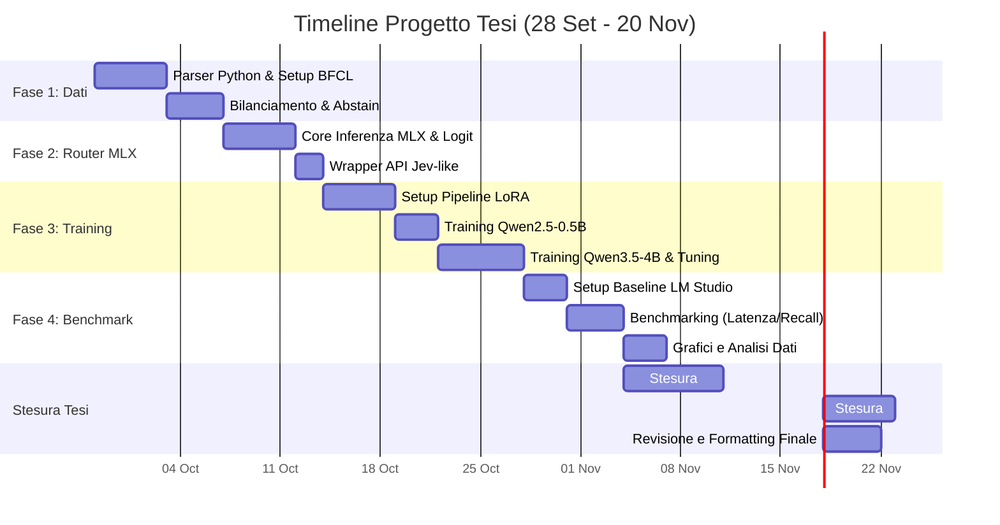

# Timeline Progetto Tesi: Custom System One Router
**Inizio:** 28 Settembre
**Deadline Consegna:** 20 Novembre
**Tempo a disposizione:** 7 settimane e mezza (~53 giorni).

## Valutazione di Fattibilità
**Risposta breve: Sì, ce la puoi fare.** 
53 giorni sono un tempo sufficiente per un progetto di questa portata, ma **i margini di errore sono stretti**. Il rischio maggiore non è scrivere il codice, ma il *training del modello* (Fase 3): se la loss non scende, potresti perdere giorni a fare debug sui dati. Per farcela, devi attenerti rigorosamente alla timeline sottostante, dedicando le ultime due settimane quasi esclusivamente alla stesura del documento finale.

## Diagramma di Gantt

## Dettaglio Settimanale

### Settimana 1 (28 Set - 6 Ott): I Dati
- **Obiettivo:** Scaricare il dataset BFCL, estrarre un sottoinsieme pulito e scrivere uno script per convertirlo in formato "State + Multiple Choice".
- **Criticità:** Assicurarsi che il token di risposta (es. "C") corrisponda esattamente a un singolo token nel vocabolario di Qwen.

### Settimana 2 (7 Ott - 13 Ott): Il Framework
- **Obiettivo:** Scrivere lo script di inferenza usando MLX. Il modello deve caricare i pesi base (zero-shot), fare il caching del prompt utente e restituire la probabilità su A, B, C.
- **Criticità:** Lavorare con le API a basso livello di MLX per estrarre solo i logit dell'ultimo token senza generare testo.

### Settimana 3 (14 Ott - 20 Ott): Primi Addestramenti
- **Obiettivo:** Avviare la pipeline di addestramento supervisionato (`mlx-lm`). Si parte dal modello piccolo (`0.5B`) per verificare che l'addestramento non vada in errore.
- **Criticità:** OOM (Out of Memory) se i batch sono troppo grandi. Debuggare la Loss se non scende.

### Settimana 4 (21 Ott - 27 Ott): Fine-Tuning Definitivo
- **Obiettivo:** Addestramento finale del modello 4B e messa a punto (Hyperparameter tuning: learning rate, epoche).
- **Criticità:** Il modello a 4B impiegherà ore. C'è il rischio di dover ripetere il run se va in overfitting.

### Settimana 5 (28 Ott - 3 Nov): Benchmarking
- **Obiettivo:** Confrontare il tuo Router addestrato con un classico LLM (via LM Studio). Raccogliere i dati di Latenza (millisecondi vs secondi) e Accuratezza.
- **Criticità:** Scrivere script automatizzati che interroghino entrambi i sistemi e salvino i risultati su un CSV senza crashare a metà.

### Settimane 6 e 7 (4 Nov - 20 Nov): Stesura e Chiusura
- **Obiettivo:** Tutto lo sviluppo DEVE essere concluso. Queste due settimane sono dedicate esclusivamente a scrivere i capitoli, generare i grafici per il trade-off accuratezza/latenza, e curare la formattazione.
- **Strategia:** Inizia dai capitoli tecnici (cosa hai fatto), poi lo Stato dell'Arte, e infine Introduzione e Conclusioni (che si scrivono sempre alla fine).
