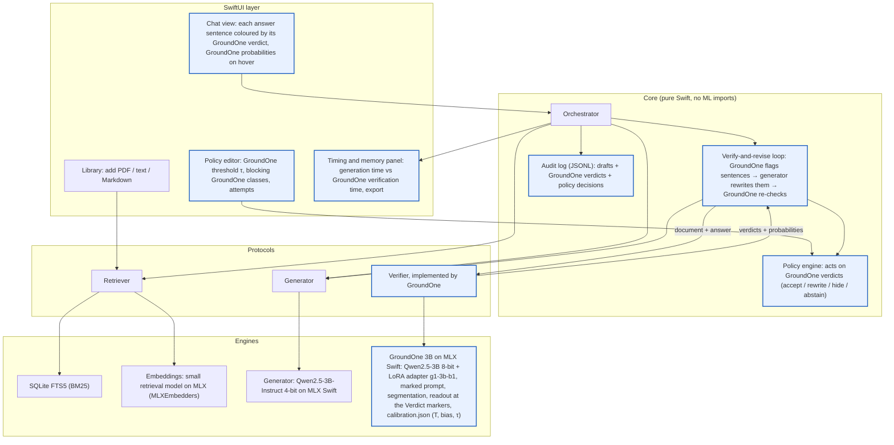

# Demo application: runtime choice and architecture

> **Status:** v0.5 (2026-10-24): **implemented** in `Project/demo/GroundOne Studio/` (see its README and §13 for what was built, measured and changed during implementation; progress log in `Project/demo/docs/progress.md`). v0.4: corpora decided, §4b; source links, §4c; judge comparison mandatory. Runtime decided by the author (option A, D28); answers to the open questions in §12.
> Name: **GroundOne Studio** (final, 2026-10-24).
> Supersedes the demo specification in `implementation_plan.md` §11 (web page, flag only, two days). Sources are summarised in the wiki (`Vault/wiki/concepts/Demo Runtime Choice.md` and the pages linked there).

---

## 1. What the demo must show

The demo is the end-to-end proof of the locality pillar: a RAG assistant in which **retrieval, generation and verification all run in one process on the 16 GB laptop**, and in which GroundOne is not just a colouring layer but the component that decides what the user is shown.

It must make five things visible, each tied to a thesis claim:

| What the user sees | Claim it supports |
| --- | --- |
| Every answer sentence coloured by its verdict, with calibrated probabilities on hover | RQ3 (usable probabilities), D27 (one served rule) |
| Flagged sentences rewritten from the document, then re-verified, up to a limit set by policy | Verification is cheap enough to sit inside the generation loop (cost model, Ch. 2) |
| A timing panel: generation vs verification time, iterations, peak memory | Co-residence within 16 GB; verifier overhead relative to generation |
| **Comparison with a generative judge on the same answer (mandatory)**: the same 3B base model without the adapter, with the terse-judge prompt of B0a, judges the answer; the panel shows both verdicts and both times side by side | RQ2 (latency vs K) and the value of the readout, shown live instead of in a table |
| Links from each verified sentence to the exact passage of the source file that supports it (green) or contradicts it (red) | Usefulness of per-sentence verdicts; first prototype of attribution, listed as future work in Ch. 9 (§4c) |

Nothing in the demo is a new benchmark: measurements taken in it are reported as a case study in a dedicated thesis chapter (Q5), never mixed into the results matrix.

## 2. Why Swift and MLX Swift (option A)

### 2.1 Candidates

| Option | Stack | Verifier path | UI |
| --- | --- | --- | --- |
| **A** | Swift + SwiftUI + MLX Swift (`mlx-swift`, `mlx-swift-lm`) | in-process, same MLX kernels as training | native macOS |
| B | Python app around the existing package (FastAPI + web page, or a Qt UI) | in-process (the current `groundone serve`) | browser or Qt |
| C | Rust: Tauri shell + `mlx-rs` or `candle` | `mlx-rs` (community bindings over `mlx-c`) or a reimplementation in candle | web view |
| D | Any shell + llama.cpp (GGUF) | converted weights, different kernels and quantisation | any |

### 2.2 Criteria and assessment

| Criterion | A Swift/MLX | B Python | C Rust | D llama.cpp |
| --- | --- | --- | --- | --- |
| Reuses the trained adapters and the calibration unchanged | yes (same MLX weights; parity to verify, §5) | yes, identical code | `mlx-rs`: likely; candle: weights to remap, parity to prove | no: GGUF conversion and requantisation, calibration to refit on dev |
| Numerical parity with the thesis results | expected (same library), checked by the conformance test | exact | to prove | lost by construction |
| One self-contained, signed app; no interpreter to ship | yes (`.app`) | no (Python runtime and venv, or a heavy bundle) | yes | yes |
| Native document and text APIs (PDF, sentence tokenizer, embeddings) | PDFKit, NaturalLanguage, SQLite on the system | Python libraries | crates, or Swift plugins | depends on the shell |
| Maintenance of the ML layer | Apple's `ml-explore` team; `mlx-swift-lm` 3.x had breaking changes | Apple (`mlx`, `mlx-lm`) | `mlx-rs` community-maintained (oxiglade); candle by Hugging Face | ggml community, very active |
| Portability beyond the Mac | UI Apple-only; MLX (and MLX Swift via CMake) also builds on Linux, CPU or CUDA; no Windows | Mac only for MLX (Linux CUDA backend exists) | UI portable; GPU backend still per platform | widest (CUDA, Vulkan, Metal, CPU) |
| Development cost in the remaining time | port of prompt, segmentation and readout (§5) + UI | lowest (code exists) | port + bindings + web UI | port + recalibration |

### 2.3 The argument for the thesis

- **Locality as a product property, not a lab setting.** Option B would run the same model, but as a Python server and a browser tab; it shows that the experiment can be served locally, not that a local application can be built around it. A native app with the verifier linked in-process is the stronger form of the claim, and it is what an end user or a company would install.
- **No retraining, no recalibration.** The adapters and `calibration.json` are MLX artefacts. MLX Swift loads the same safetensors and runs the same kernels, so the thesis results apply to the demo as long as the conformance test passes (§5). Options C (candle) and D would require re-establishing parity or refitting the calibration on dev, i.e. partly redoing the experiment.
- **Platform integration.** PDF extraction (PDFKit), a sentence tokenizer and sentence embeddings (NaturalLanguage) and SQLite with FTS5 ship with macOS: retrieval needs no extra model download.
- **Honest costs, to state in the thesis.** The UI ties the demo to Apple platforms; MLX Swift requires Xcode for the Metal shaders (SwiftPM on the command line cannot build them); `mlx-swift-lm` changes API between majors; pysbd has no Swift port (§5.2). Portability is addressed by the architecture (§3: the inference engine sits behind protocols) and by the llama.cpp port already listed as future work (Ch. 9), not by this demo.

## 3. Architecture



Blue nodes are where GroundOne is used: as the engine behind the `Verifier` protocol (one forward pass per draft), and through its verdicts in the loop, the policy engine, the audit log, the chat colouring and the timing panel.

- **Core** knows only the three protocols and the policy. It can be unit-tested with fake engines, as the Python package is tested with the fake backend.
- **Engines** are replaceable: a llama.cpp generator or a GroundOne port on another runtime implement the same protocols.
- **The judge of the comparison mode is local**: the same Qwen2.5-3B 8-bit base that GroundOne uses, with the LoRA adapter unloaded (`LoRAContainer.unload`) and the B0a terse-judge prompt. It is exactly the judge measured in the thesis, it costs no extra memory, and it never leaves the machine. A remote judge would contradict the locality pillar.
- **One inference actor.** All MLX calls run on one Swift actor, the counterpart of the single MLX worker thread in `engine.py`: generation and verification share the GPU and are serialised, so timings are not confounded by contention.

Protocol sketch (names indicative):

```swift
protocol Retriever { func search(_ query: String, k: Int) async throws -> [Passage] }
protocol Generator { func answer(question: String, context: [Passage], instructions: String?) -> AsyncThrowingStream<String, Error> }
protocol Verifier  { func verify(document: String, answer: String) async throws -> Verdicts }   // implemented by GroundOneVerifier: one forward pass
protocol Judge     { func judge(document: String, sentences: [String]) async throws -> JudgeVerdicts }  // B0a prompt, adapter unloaded
protocol Attributor { func sources(for sentence: Int, verdict: SentenceVerdict, passages: [Passage]) async throws -> [SourceLink] } // §4c, lazy

struct SentenceVerdict { let range: Range<String.Index>; let scored: Bool
                         let probs: (supported: Double, contradicted: Double, notMentioned: Double); let label: Label }
```

## 4. One query, step by step

1. **Retrieve.** Top-k passages for the question, hybrid: BM25 (SQLite FTS5) and dense embeddings, scores fused (e.g. reciprocal rank fusion). The embeddings come from a small retrieval-trained model on MLX (`MLXEmbedders`), chosen in M2 on a small retrieval check (NLEmbedding as a no-download fallback). The concatenated passages are the *document* that GroundOne reads, exactly as in training.
2. **Generate.** The 3B generator streams an answer grounded in the passages.
3. **Segment.** The answer is split with the training rule (pysbd-equivalent + checkable-content rule, §5.2).
4. **Verify.** One GroundOne pass over document + numbered sentences; calibrated probabilities and labels by the served rule (supported iff P(supported) ≥ τ, else the argmax of the other two; D27).
5. **Apply the policy.** If no sentence is blocking, show the answer. Otherwise:
6. **Revise.** Ask the generator to rewrite *only* the flagged sentences, giving it the passages and the verdict ("contradicted by the document" / "not in the document"), keep the accepted sentences fixed, and re-verify the whole new answer (one pass again).
7. **Stop** when nothing is blocking or after `max_attempts`; then apply `on_failure` (highlight, hide the sentence, or abstain with a fixed message).
8. **Log** every step (question, passages, each draft, verdicts, timings, policy) to the audit log.

Design choices behind the loop, from the literature in the wiki (`Verify-and-Revise Loops`):

- **External feedback, targeted edits.** Intrinsic self-correction without external signal does not reliably help (Huang et al. 2024); the loops that work use an external critic or evidence (RARR, CRITIC, CoVe). GroundOne is that external critic, and it is cheap: a re-check costs one prefill, not a generated critique.
- **Edit only what is flagged** (as RARR does) so that verified sentences are not lost and the loop converges.
- **"Not mentioned" may mean a retrieval miss**, not a generation error. An optional step re-queries the retriever with the flagged sentence before rewriting (in the spirit of CRAG). Stretch item.
- **The verifier can be wrong.** A loop driven by GroundOne inherits its false alarms (more rewrites) and its misses (unflagged errors). The demo reports this; it does not present the loop as a measured accuracy gain (§8).
- **The generator may not repair.** In Self-Refine, Vicuna-13B could not refine even with oracle feedback; a 3B generator may hedge or delete instead of fixing (CoVe gains precision partly by deletion). Log what each round changes.
- **Few rounds.** Most of the gain in the literature comes in 2–3 rounds; `max_attempts` defaults to 2.

## 4b. Document corpora (author, 2026-10-24)

Two corpora with two roles:

| Corpus | Role | Why | Limit |
| --- | --- | --- | --- |
| **T1 documents (RAGTruth test)**: MS MARCO passages with their questions, CNN/DailyMail articles, Yelp records, with the original questions and instructions | **Measurements** of the case study (timings, rounds, injected errors, D30) | In domain: calibration and τ hold as fitted; injected errors have a clean ground truth; numbers comparable with Ch. 7 | Ready-made contexts: the retriever has little to do |
| **The author's research library**: the arXiv PDFs in `Vault/raw/` | **Demonstration** of the app on real documents ("ask your research library") | Natural local use case, already on disk; many documents, so hybrid retrieval does real work; links to the wiki | Technical text far from RAGTruth: calibration not guaranteed, shown qualitatively only |
| GDPR and AI Act, English versions (EUR-Lex, reuse allowed) | Optional second demonstration, if time allows | Ties to the privacy argument of Ch. 2; long texts with precise answers | Legal language, far out of domain |

Constraint for every corpus: **documents and questions in English**, the only language GroundOne was trained and calibrated on (D7; stated as a limitation in Ch. 8, multilingual adapters as future work in Ch. 9).

## 4c. Links to the source passages (author, 2026-10-24; optional milestone M3b)

Each verified sentence can link to the exact place in the source file that supports it (green link) or contradicts it
(red link). GroundOne alone does not say *which* passage supports or contradicts a sentence (the attribution limit stated
in Ch. 8), so the link is built in two steps:

1. **Which passage: GroundOne per passage.** The answer is verified against each retrieved passage separately; the
   passage with the highest P(supported) is the supporting source, the one with the highest P(contradicted) the
   contradicting source. It reuses the model and its calibration, and it is the first prototype of the "readout per
   passage" listed as future work in Ch. 9.
2. **Where in the passage: similarity.** Inside the chosen passage, the sentence most similar to the answer sentence
   (BM25 or embeddings) is the span to highlight.

Each passage keeps its origin from ingestion: file URL, page index (PDF) and character range. Clicking a link opens the
PDF at that page and highlights the span (`PDFView` + `PDFSelection`), or scrolls a text/Markdown view to the range.

**Cost and timing.** Step 1 costs k forward passes instead of one (with k = 5 retrieved passages: about 1.5 s with the
0.5B, 8 s with the 3B), so it runs **lazily**, on click or in the background after the main verification, and is cached.
The main verification stays a single pass and the case-study timings are unaffected.

**Honesty.** Attribution was not evaluated (RAGTruth does not say which passage supports a sentence). In the thesis it is
a demonstrative feature, not a measured result; the link reads "evidence suggested by GroundOne".

**Alternative considered:** citations written by the generator ([1], [2]); a 3B generator cites unreliably, so they would
still need step 1 to be checked. Not used.

## 5. Porting GroundOne to Swift

### 5.1 What is ported, and what is reused

| Piece | Python source | Swift | Note |
| --- | --- | --- | --- |
| Base model weights | `lmstudio-community/Qwen2.5-{0.5B,3B}-Instruct-MLX-8bit` | loaded as is | same files |
| LoRA adapter | `outputs/models/<run>/best/adapters.safetensors` + `adapter_config.json` (mlx-lm format, rank 16, scale 2.0, all 36 layers for the 3B) | `LoRAContainer.from(directory:)` then `load(into:)`; `QLoRALinear` wraps the 8-bit layers; `fuse` and `unload` also exist | `adapter_config.json` uses the same keys as mlx-lm (checked in the 3.32.3 source); numerical parity still to prove (§5.3) |
| Prompt | `prompts.encode_marked`, `PROMPT_VERSION_MARKED = "groundone-v2-marked"` | port | **piecewise tokenisation**: head, each "[k] sentence", the marker " Verdict:" and "\n" are encoded separately and concatenated; encoding the joined string would give different ids |
| Segmentation | `data/segment.py` (pysbd per line, list-marker stripping, checkable-content rule) | port | §5.2 |
| Readout | `readout.py`: hidden states at marker positions → output head → logits of A/B/C only | port | `Qwen2Model.model(inputs)` is public and returns the normed final hidden states; the head (`lm_head`, or the tied `embed_tokens` for Qwen2.5 0.5B/3B) is internal to the module, so it is read from the parameter tree or the 276-line `Qwen2.swift` is copied into the app |
| Calibration | `best/calibration.json`: temperature, per-class bias, threshold τ, model fingerprint | read the JSON | 3B: T = 1.035, bias (0, −2.19, −2.06), τ = 0.925 |

### 5.2 Segmentation

pysbd has no Swift port. Options:

1. **Port the subset of pysbd rules** that fire on RAG answers (abbreviations, decimals, ellipses, quotes); measure agreement with pysbd on the T1 answers.
2. **Use `NLTokenizer(unit: .sentence)`** plus the same list-marker and checkable-content rules; measure agreement with pysbd on T1.
3. **Ship the segmentation as data at first**: the conformance test runs on pre-segmented answers, and the app uses option 2 until agreement is measured.

Decision (2026-10-22): start with 3 + 2, measure agreement on T1, port pysbd rules only if disagreement is material (say > 2 % of answers).

### 5.3 Conformance test (the gate)

Python exports a fixture file from N frozen T1 answers (proposal: 200, stratified by K like the latency subset): document, sentences, scored flags, token ids, marker positions, raw A/B/C logits, calibrated probabilities, served labels. The Swift test target must reproduce:

| Check | Pass condition |
| --- | --- |
| Token ids and marker positions | identical |
| Raw logits at markers | max \|Δ\| small enough that every probability below passes |
| Calibrated probabilities | \|Δp\| < 0.01 for every class and sentence |
| Served labels | identical on ≥ 99.5 % of sentences; every disagreement within 0.01 of τ |
| Segmentation (separate test) | agreement with pysbd reported, not gated |

If the test passes, the thesis numbers hold for the app and nothing is retrained or recalibrated. If it fails, the cause is found before any UI work (milestone M1 is a gate).

## 6. Memory budget (16 GB, estimates to replace by measurement)

| Component | Size | Source |
| --- | --- | --- |
| GroundOne 3B verifier (8-bit base + LoRA) | 3.28 GB + 0.12 GB | measured file sizes |
| Generator Qwen2.5-3B-Instruct 4-bit (`mlx-community/Qwen2.5-3B-Instruct-4bit`, already cached) | 1.6 GB on disk | measured file size |
| KV caches (3B: 36 layers × 2 KV heads × 128 dims, bf16) | ≈ 36 KB per token, ≈ 0.15 GB at 4k tokens | arithmetic |
| Retrieval index (SQLite FTS5, embeddings) | tens of MB for hundreds of pages *(estimate)* | |
| App, macOS, other processes | several GB | measured at run time |

**Alternative worth measuring: one shared base.** The verifier's base *is* Qwen2.5-3B-Instruct (8-bit). The generator could be the same weights with the adapter switched off (`LoRAContainer.unload` / `load`, or LoRA layers kept with a zero scale), so one 3.3 GB copy serves both roles. This saves ≈ 1.8 GB but decodes at the 8-bit floor (≈ 27 ms/token on the M4) instead of the 4-bit one. Decision (Q2): separate 4-bit generator; the shared base stays an option to measure if memory is tight.

## 7. Policies

A policy is a small JSON file, selectable in the UI and recorded in every audit entry:

```json
{
  "name": "strict-legal",
  "verifier": "g1-3b-b1",
  "threshold": "calibrated",          // τ from calibration.json, or a number
  "blocking": ["contradicted", "not_mentioned"],   // lenient: ["contradicted"]
  "max_attempts": 2,
  "on_failure": "abstain",            // "highlight" | "hide" | "abstain"
  "show_probabilities": true,
  "audit_log": true
}
```

Strict and lenient correspond to the two policies already derived from the three probabilities in the thesis (D20). Programmable rails in NeMo Guardrails are the reference point in the literature: its fact-checking rail is a yes/no LLM prompt on the whole response, and rails block or abstain without sending the verdict back for a targeted rewrite (it is also Python-only and sends telemetry by default). Here the rail is a single learned, calibrated per-sentence check with an explicit threshold, which is simpler and auditable; CRAG's thresholded actions are the closest precedent.

## 8. Measurement mode

What the app logs per query (exported as JSONL, plotted by a script in `groundone figures`):

- time to retrieve, time to first token and total generation time, verification time per pass, number of revision rounds, final status (accepted, hidden, abstained);
- K, document length in tokens, generated tokens;
- peak resident memory of the app (and of the system), to answer the co-residence item of the locality pillar;
- the same answer judged by the terse generative judge (same 3B base without the adapter, B0a prompt), with its time and generated tokens (mandatory comparison, §1).

**Injected errors (D30, 2026-10-19).** The case study takes answers that GroundOne accepts as fully supported, injects controlled errors (a number, name or date swapped for one absent from the document or contradicting it; one fabricated sentence), and measures how many errors survive without the loop, after one round and after two, plus how many correct sentences the loop changes. The injected positions are the ground truth, independent of GroundOne. The literature also asks for: preservation of correct content (RARR), transitions in both directions (wrong → right and right → wrong; Huang et al. 2024), repair success per round, and an equal-compute best-of-N baseline (sample N answers, keep the one GroundOne accepts).

**Honesty rule.** The demo shows that verification fits in the loop and what it costs. Faithfulness gains of the loop are measured only through the injected errors (D30); results are worded as "accepted by GroundOne", not "correct". No second verifier is used (author, 2026-10-24: the demo is a demonstration, not a product). **Limitation to state in the demo chapter:** sentences rewritten by the generator have no reference label, so their correctness is judged only by GroundOne, the same model that stops the loop; a rewrite that falls in one of GroundOne's blind spots would count as a successful repair. **Future work:** an independent check of the rewrites (a second verifier such as MiniCheck-RoBERTa, or a human reading of a sample).

## 9. Milestones (proposal; experiment freeze 2026-10-30)

| # | Content | Exit criterion | Days *(estimate)* |
| --- | --- | --- | --- |
| M0 | Xcode project, MLX Swift loads Qwen2.5-3B and streams an answer | text appears in a SwiftUI window | 0.5 |
| M1 | GroundOne verifier in Swift + fixture export in Python + conformance test | §5.3 passes on the 3B (and the 0.5B) | 1.5–2 |
| M2 | Library (PDF/text), SQLite FTS5 retrieval, chat with coloured sentences | end-to-end answer with verdicts | 1 |
| M3 | Policy engine, verify-and-revise loop, audit log | loop stops by policy; log complete | 1 |
| M3b *(optional)* | Links to the source passages (§4c) | a click opens the PDF at the highlighted span | 0.5–1 |
| M4 | Measurement mode, **judge comparison (mandatory)**, export, figures | figures for the thesis | 1 |
| M5 | Polish, screenshots, README | — | 0.5 |

About 5.5–6 working days; the 30 October freeze is self-imposed and the demo may run past it (decision 15). **Fallback if M1 fails:** the SwiftUI app keeps the same Core and calls the existing `groundone serve` on 127.0.0.1 for verification (still fully local, but two processes), and the Swift port goes to future work.

## 10. Repository layout (proposal; as built in §13)

```
Project/GroundOneStudio/      # Xcode project, own README (name provisional, Q1; location confirmed, Q4)
  App/                        # SwiftUI views
  Core/                       # orchestrator, loop, policy, audit (no ML imports)
  Engines/                    # MLXGenerator, GroundOneVerifier, LocalJudge, Attributor, FTSRetriever, Embeddings
  Tests/Conformance/          # fixtures exported by Python + tests
  Policies/                   # example policy JSON files
Project/GroundOne/src/groundone/tools/export_fixtures.py   # Python side of the conformance test
```

Models are not copied into the app bundle: the app reads them from the Hugging Face cache and from `Project/outputs/models/` (gitignored as now).

## 11. Risks

| Risk | Mitigation |
| --- | --- |
| `mlx-swift-lm` behaves differently from mlx-lm (tokenizer from swift-transformers, LoRA application order, attention mask) | the conformance test compares token ids and logits, not only labels; copy of `Qwen2.swift` if a change is needed; the version is pinned (3.32.3) |
| Segmentation differs from pysbd | measured on T1 (§5.2); the verifier's numbers are unaffected because the conformance test uses fixed sentences |
| Generator + verifier exceed memory, or swap | 0.5B verifier, shared base (§6), shorter retrieval context; measure under the memory guard logic |
| The loop does not converge (verifier keeps flagging) | `max_attempts`, on-failure action; report the distribution of rounds |
| Time: the demo eats the thesis | M1 is a gate; fallback to the Python server; demo polish is first on the cut list (`implementation_plan.md` §9) |

## 12. Decisions on the open questions (author, 2026-10-18)

| # | Question | Answer |
| --- | --- | --- |
| 1 | Name | **GroundOne Studio** (final, 2026-10-24) |
| 2 | Generator | **separate Qwen2.5-3B-Instruct 4-bit** (cached, 1.6 GB); shared base only as a measured option |
| 3 | Retriever | **hybrid**: BM25 (FTS5) + embeddings. Embeddings (2026-10-24): **a small retrieval-trained open-weight embedding model on MLX** (`MLXEmbedders`), downloaded once; NLEmbedding only as a no-download fallback; the exact model chosen in M2 among those `MLXEmbedders` supports, after a check on about ten questions. **Chosen: `BAAI/bge-small-en-v1.5`** (133 MB, MIT) after the retrieval check of §13 |
| 4 | Location | `Project/GroundOneStudio/` |
| 5 | Thesis placement | **own chapter** (application and case study) |
| 6 | Loop evaluation | **Injected errors as ground truth (D30)**, see §8; **no second verifier** (2026-10-24), limitation and future work stated instead. Author's view: GroundOne does not repair; it flags, the generator rewrites, GroundOne re-checks, so the design has no circularity. Agreed for the app. The only caution is in the wording of results: "accepted by GroundOne" is what the loop guarantees by construction (it stops when GroundOne accepts), not "correct"; GroundOne's misses survive the loop and its false alarms cause needless rewrites. Independent check of the rewrites dropped (2026-10-24): stated as a limitation, listed as future work |
| 7 | Segmentation | **NLTokenizer + same list-marker and checkable-content rules; agreement with pysbd measured on T1** (confirmed 2026-10-22) |
| 8 | Time budget | about six working days, accepted; the app comes after the remaining experiment items |
| 12 | Verifier in the app (2026-10-24) | **GroundOne 3B by default**, with a selector for the 0.5B (faster, Apache 2.0) |
| 13 | Injected-error protocol (2026-10-24) | **100 T1 answers accepted by GroundOne, one injected error each**, split between swapped number/name/date and one fabricated sentence |
| 14 | UI language (2026-10-24) | **English**, consistent with the documents and the model |
| 15 | Schedule (2026-10-24) | The 30 October freeze is self-imposed; the demo may finish after it without consequences (author) |
| 10 | Judge comparison (2026-10-24) | **Mandatory**, not optional; local judge = GroundOne's base without the adapter, B0a prompt |
| 11 | Source links (2026-10-24) | **Accepted** as optional milestone M3b: GroundOne per passage + similarity, lazy and cached; demonstrative, not measured (§4c) |
| 9 | Document corpora (2026-10-24) | **T1 documents for the measurements, the author's arXiv library in `Vault/raw/` for the demonstration**; GDPR/AI Act optional; English only (§4b) |

## 13. Implementation (2026-10-24)

**Where.** `Project/demo/GroundOne Studio/` (folder created by the author; replaces `Project/GroundOneStudio/` of §10):
`project.yml` (XcodeGen; the `.xcodeproj` is generated), `App/` (SwiftUI), `UITests/`, `Policies/`, `scripts/uitest.sh`,
and the Swift package `Packages/GroundOneKit` with `GroundOneCore` (no ML imports), `GroundOneEngines` (MLX) and the
command-line tool `g1studio`. Python side: `groundone/tools/export_fixtures.py`; case-study scripts in
`Project/experiments/demo/scripts/`. Outputs in `Project/outputs/demo/` (only summaries tracked). Pins: mlx-swift-lm
3.32.3, mlx-swift 0.32.3, swift-transformers 1.3.5 (tokenizer only).

**Conformance gate (§5.3)**, 200 T1 answers stratified by K, 1,747 markers, Swift logits on the Python token ids:

| Check | 3B (default) | 0.5B |
| --- | --- | --- |
| token ids / marker positions identical | 200/200, 200/200 | 200/200, 200/200 |
| max \|Δlogit\| | 0.070 | 0.172 |
| max \|Δp\| calibrated | 0.0048 | 0.031 |
| sentences with \|Δp\| < 0.01 | 100 % | 99.83 % (3 above) |
| served labels identical | 100 % | 99.71 % (all within 0.01 of τ) |
| gate | **PASS** | fails only the strict \|Δp\| criterion on 3 sentences |

The thesis numbers hold for the app with the 3B; for the 0.5B they hold for the labels (every disagreement sits at the
threshold). No retraining or recalibration.

**Segmentation (§5.2).** NLTokenizer port vs pysbd on all 2,647 T1 answers: identical segmentation on **98.4 %** of
answers after adding three pysbd-like rules (no break after initials or common abbreviations, none before a lowercase
word, list markers merged); 95.2 % without them. Above the 98 % bar of decision 7; pysbd rules not ported further.

**Retrieval check (decision 3)**, research library (109 files, 5,886 passages), 12 questions with a known source paper:
hybrid BM25 + dense reaches hit@5 = 1.00 and MRR = 1.00 with both bge-small-en-v1.5 and Qwen3-Embedding-0.6B-4bit;
dense alone: bge 0.90 MRR, Qwen3 0.82; BM25 alone 0.92. The check is small and at the ceiling; bge-small chosen as equal
here, 2.5× smaller and 3× faster.

**Changes made during implementation (to state in the demo chapter).**
- *App data location.* The app keeps its data in `~/Library/Application Support/GroundOne Studio/` (adapters with
  calibration, the library index with copies of its files, policies, audit log), filled by `g1studio install`; models stay
  in the Hugging Face cache. Reason: macOS privacy protection (TCC) blocks an app's access to `~/Desktop` until the user
  approves a dialog, which froze the launch. The command-line tools read the workspace directly.
- *MLX memory limits.* The Swift engines set MLX's buffer cache to 1 GB and the memory limit to 11 GB, as `backend.py`
  does; without them a variable-length workload (indexing) grew to 11 GB and swapped.
- *Source links (§4c).* Span inside the chosen passage by word overlap (a BM25-like score), not embeddings.
- *Judge parse.* Same lenient parser as `judges.py` (last A/B/C on the line `<n>: …`).
- *Measurements.* The case study runs from the command line (`g1studio casestudy`, same engines and loop as the app,
  Release build, under the guard); the app's Measurements view shows the session and the case-study summary.
