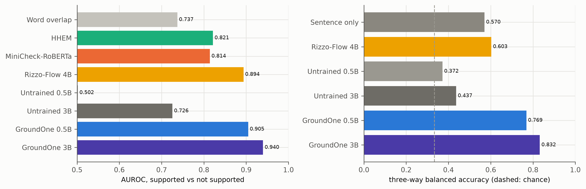
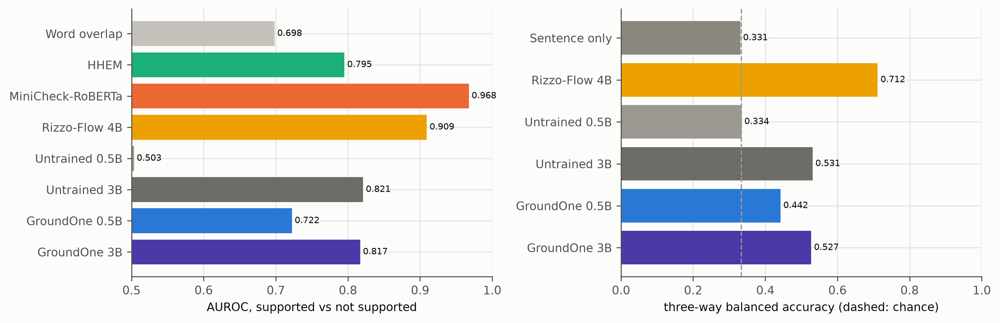
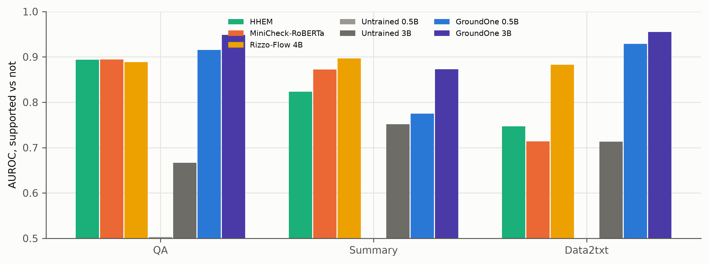
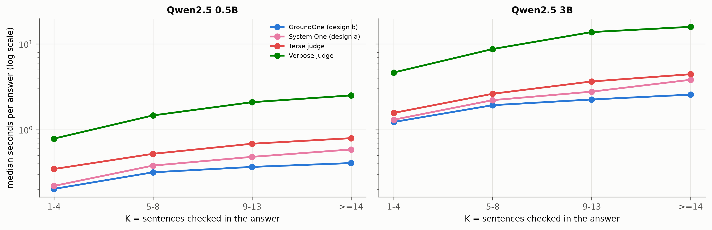
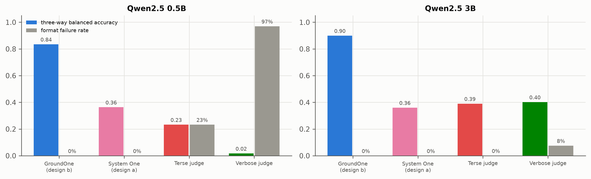

# Benchmarks on the frozen test sets

Generated by `groundone figures`; regenerate after new results. Captions are drafts for the thesis.

## comparison_t1.png

T1 RAGTruth test: AUROC of P(supported) for every system, and three-way balanced accuracy for systems with a three-way output. Word overlap and the sentence-only classifier never verify the sentence against the document. Rizzo-Flow and the untrained 3B are evaluated on subsamples (see metrics files).

*Source: results/*/t1/metrics.json*

## comparison_t3.png

T3 VitaminC test: AUROC of P(supported) for every system, and three-way balanced accuracy for systems with a three-way output. Word overlap and the sentence-only classifier never verify the sentence against the document. Rizzo-Flow and the untrained 3B are evaluated on subsamples (see metrics files).

*Source: results/*/t3/metrics.json*

## t1_by_task.png

T1 (RAGTruth test) AUROC per task for each system.

*Source: results/*/t1/metrics.json*

## latency_vs_K.png

Latency per answer as a function of K on the same T1 answers (in-process MLX, one answer at a time, M4 16 GB). Generative judges write a verdict per sentence; the System One reads all K verdicts without generating text.

*Source: results/*/latency/metrics.json*

## judges_quality_failures.png

On the latency subset: three-way balanced accuracy (format failures counted as wrong) and share of sentences whose verdict could not be parsed. System One outputs are always valid.

*Source: results/*/latency/metrics.json*
