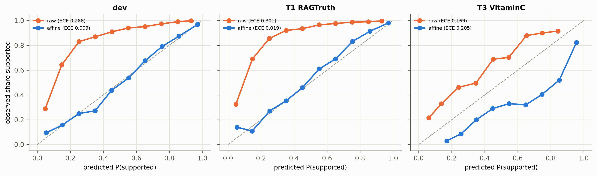
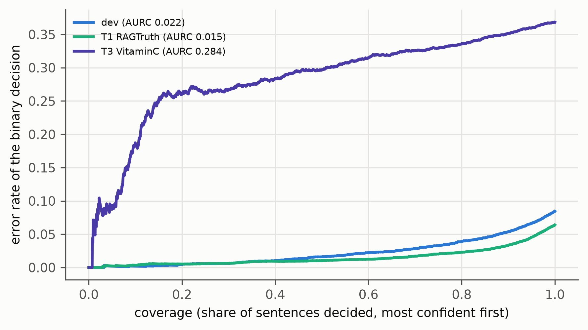

# Calibration: g1-05b-b1

Generated by `groundone figures`; regenerate after new results. Captions are drafts for the thesis.

## reliability_binary.png

Reliability of P(supported) before (raw) and after temperature + bias calibration fitted on dev (run g1-05b-b1); bins with at least 20 sentences.

*Source: results/g1-05b-b1/calibration/metrics.json*

## risk_coverage.png

Selective prediction: error rate of the supported / unsupported decision as the least confident sentences are deferred (calibrated probabilities, run g1-05b-b1).

*Source: results/g1-05b-b1/calibration/metrics.json*
