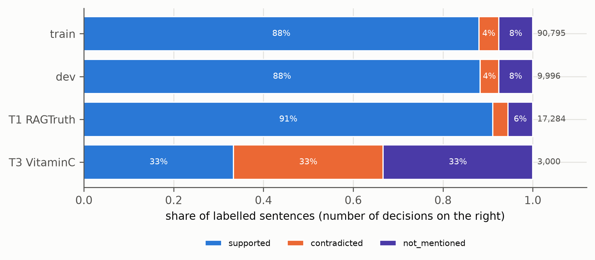
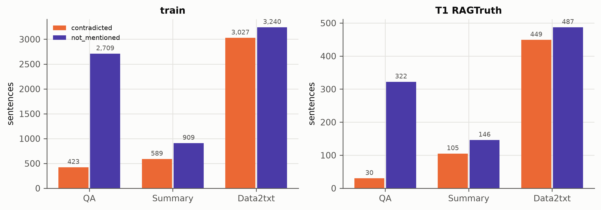
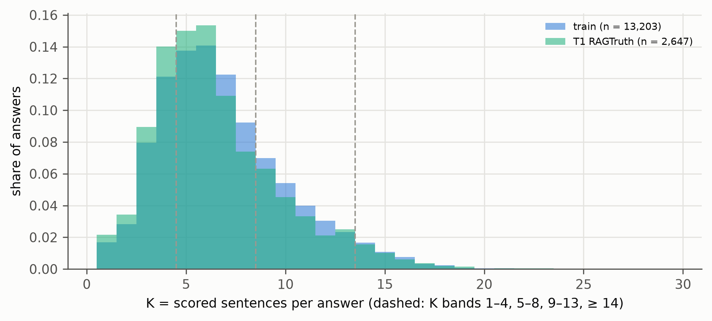
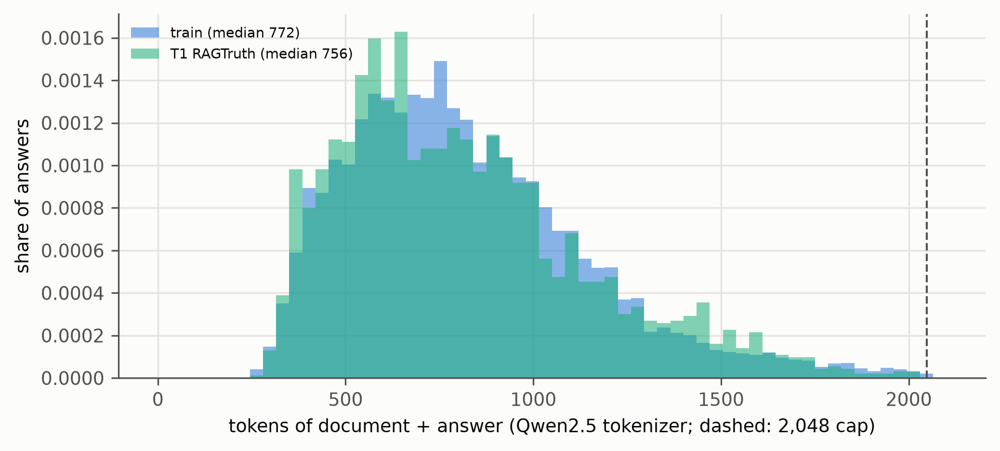
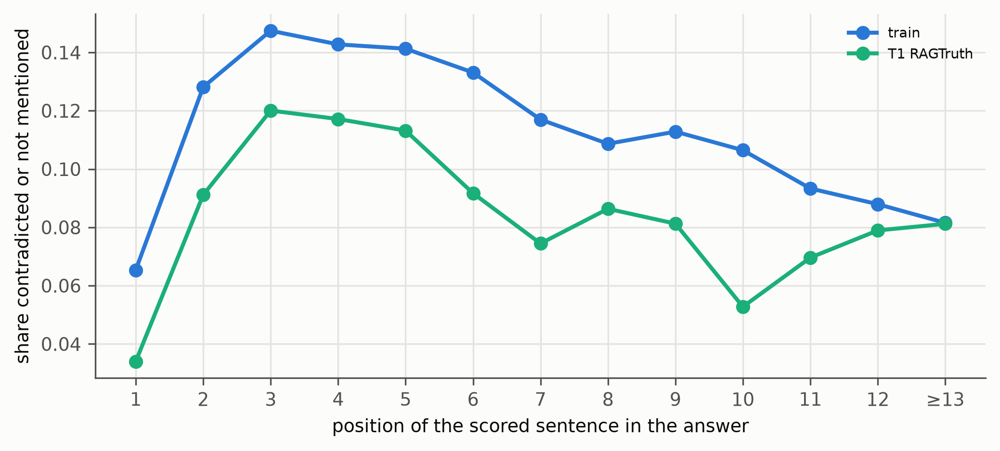

# Dataset figures

Generated by `groundone figures`; regenerate after new results. Captions are drafts for the thesis.

## class_balance_by_split.png

Class balance of the labelled sentences in each split. RAGTruth (train, dev, T1) is about 89 % supported; T3 is sampled to 1,000 pairs per class.

*Source: data/processed/groundone/*.jsonl*

## minority_classes_by_task.png

Contradicted and not-mentioned sentences per RAGTruth task. Contradictions come mostly from data-to-text; in T1 QA has very few, so its contradicted recall is only indicative.

*Source: data/processed/groundone/{train,test_ragtruth}.jsonl*

## K_distribution.png

Distribution of K (scored sentences per answer) in train and T1, with the K bands used for the K curves.

*Source: data/processed/groundone/{train,test_ragtruth}.jsonl*

## prompt_length.png

Length of document plus answer in Qwen2.5 tokens; answers over the 2,048-token cap are excluded (counts in the data card).

*Source: data/processed/groundone/{train,test_ragtruth}.jsonl*

## unsupported_by_position.png

Share of contradicted or not-mentioned sentences by position in the answer: the first sentence is rarely unsupported (3–7 %), the share peaks at positions 3–5 (12–15 %) and stays at 8–11 % in late positions, so long answers still contain errors to catch at the end.

*Source: data/processed/groundone/{train,test_ragtruth}.jsonl*
