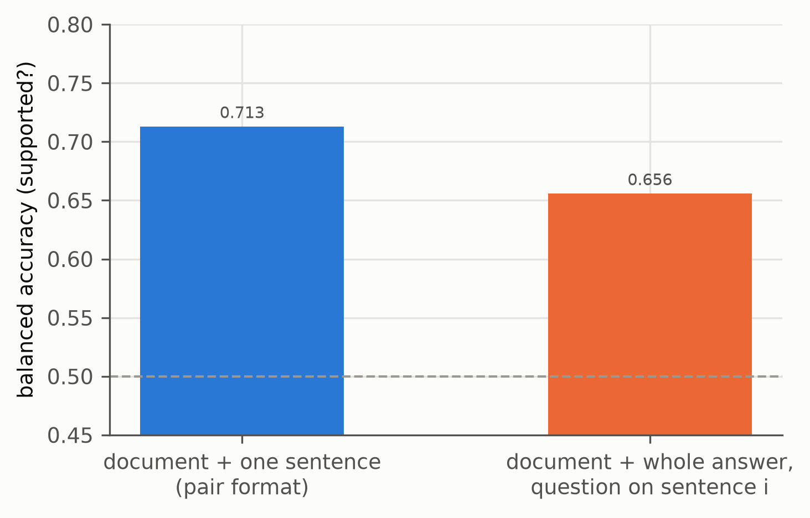
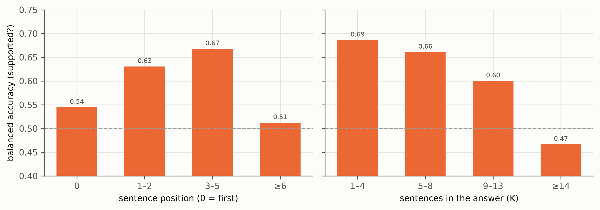
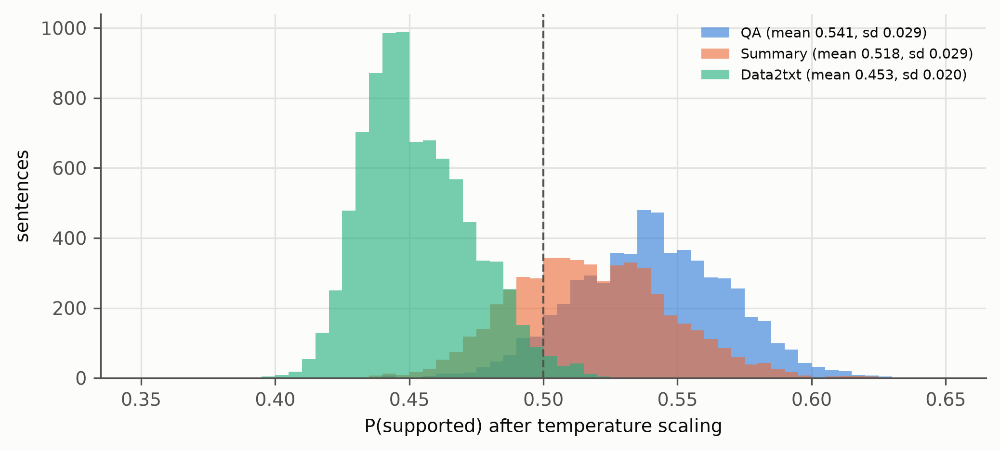
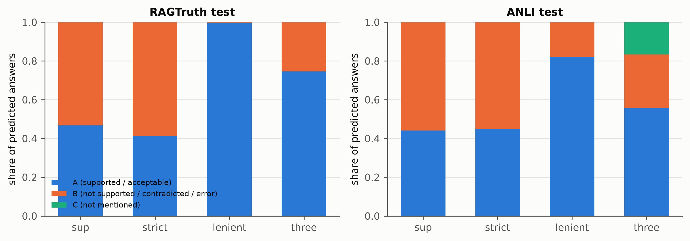

# Diagnostics: g1-05b-v1

Generated by `groundone figures`; regenerate after new results. Captions are drafts for the thesis.

## format_effect_same_sentences.png

The same 15,224 RAGTruth test sentences scored in the two prompt formats (LLM-AggreFact labels), run g1-05b-v1. The multi-sentence System One format loses accuracy.

*Source: results/g1-05b-v1/ragtruth, results/g1-05b-v1/aggrefact*

## accuracy_by_position_and_K.png

RAGTruth test, multi-sentence format: accuracy falls for long answers (K ≥ 14 is below chance) and for late sentences (run g1-05b-v1).

*Source: results/g1-05b-v1/ragtruth*

## probability_spread_by_task.png

In the multi-sentence format the probabilities are squeezed around 0.5 (sd ≈ 0.02–0.03) and shifted per task, so a fixed threshold of 0.5 flips on a tiny bias (run g1-05b-v1).

*Source: results/g1-05b-v1/ragtruth*

## predicted_answer_shares.png

Share of each predicted answer per question (run g1-05b-v1). The lenient rule almost always answers 'acceptable' and the three-way question almost never answers 'not mentioned': these questions were not learned.

*Source: results/g1-05b-v1/ragtruth, results/g1-05b-v1/anli*
