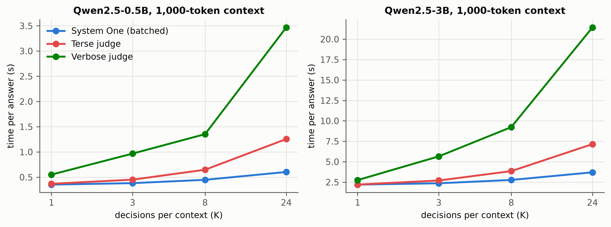
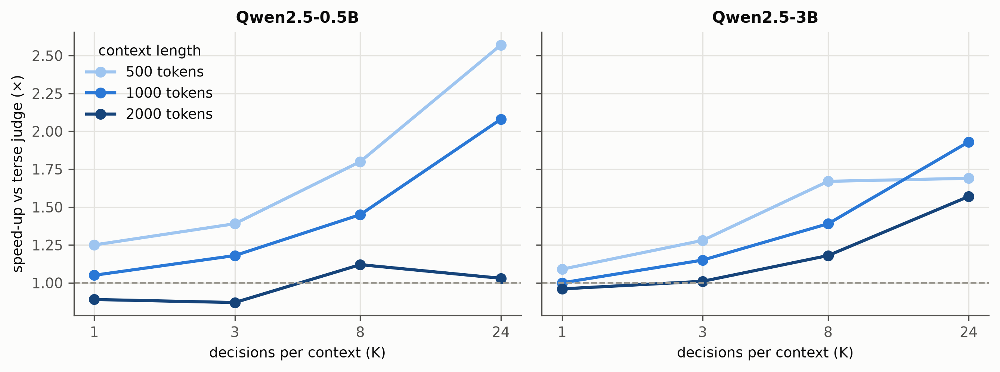
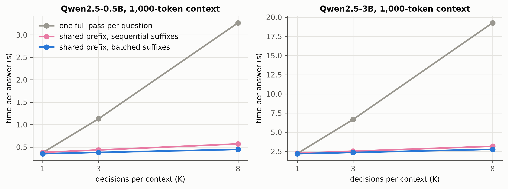
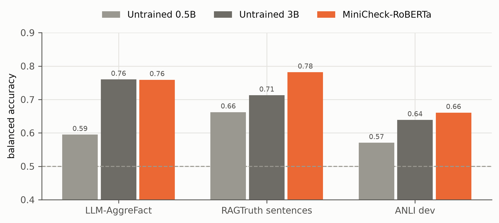
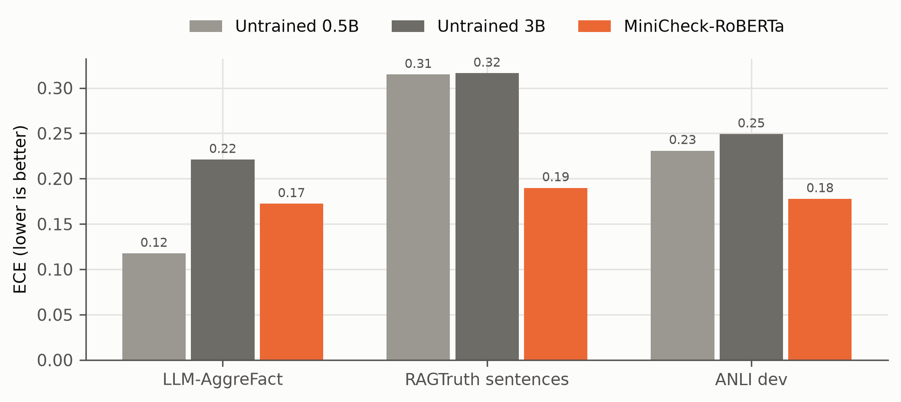
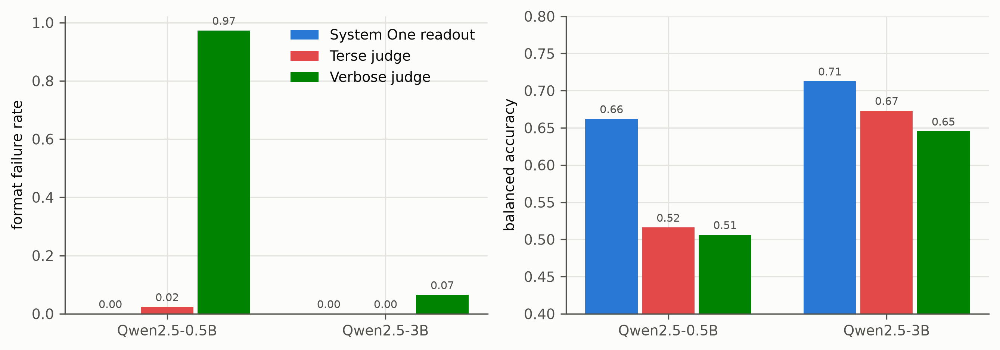
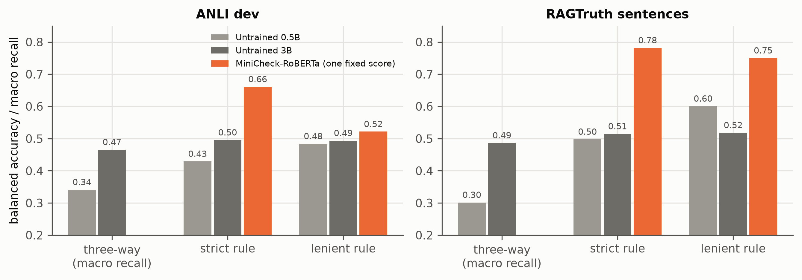
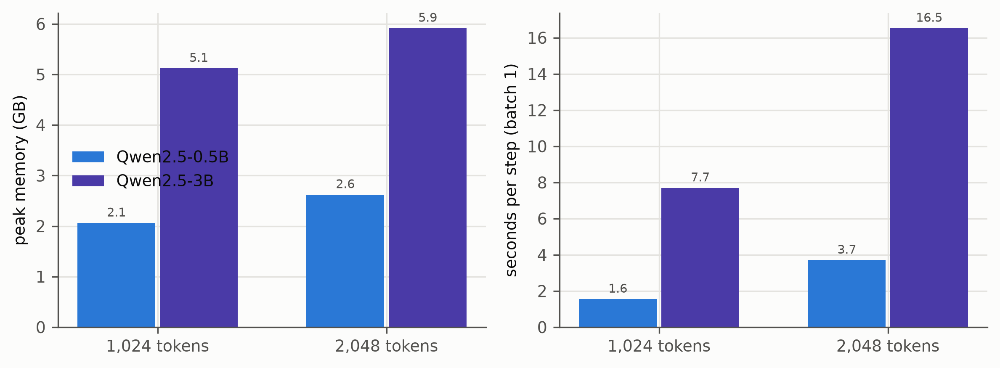

# Phase 0 / 0b figures (feasibility)

Generated by `groundone figures`; regenerate after new results. Captions are drafts for the thesis.

## p0b_latency_vs_K.png

Time to verify one answer as the number of decisions K over the same 1,000-token context grows (untrained models, M4 16 GB, MLX 8-bit). The System One scores all K questions in one batched pass after a single prefill; generative judges decode their verdicts token by token.

*Source: phase0/results/06_speed_batched_*.json*

## p0b_speedup_vs_K_by_context.png

Speed-up of the batched System One over a terse generative judge as a function of K, for three context lengths. The gain grows with K and shrinks with context length, because prefill is paid by both methods. Dashed line: no gain.

*Source: phase0/results/06_speed_batched_*.json*

## p0_system_one_variants.png

Three ways of computing K System One decisions over one context. Reusing the prefix is essential; batching the short suffixes removes most of the remaining cost (Phase 0 vs Phase 0b).

*Source: phase0/results/04_speed_*.json, 06_speed_batched_*.json*

## p0_zero_shot_bacc.png

Zero-shot balanced accuracy (threshold 0.5) of the untrained Qwen2.5 System One readout and of MiniCheck-RoBERTa on the same 1,780 evaluation items (Phase 0 sample).

*Source: phase0/results/02_readout_*.json, 03_minicheck-roberta.json*

## p0_zero_shot_ece.png

Expected calibration error (15 bins) on the same items: the untrained Qwen probabilities are poorly calibrated.

*Source: phase0/results/02_readout_*.json, 03_minicheck-roberta.json*

## p0b_generative_judges.png

Generative judges vs System One readout on 630 RAGTruth sentences (untrained models). Left: share of verdicts that could not be parsed. Right: balanced accuracy. The System One returns a valid answer by construction.

*Source: phase0/results/08_gen_judges_*.json, 02_readout_*.json*

## p0b_flexibility_zero_shot.png

Zero-shot flexibility probe: three-way question and verification rules written in the prompt. Untrained models do not follow the rules (≈ 0.5); MiniCheck cannot receive a rule, so its single score is evaluated against each rule's labels. Chance: 0.33 (three-way), 0.5 (rules).

*Source: phase0/results/07_flex_*.json*

## p0_training_probe.png

LoRA training probe on the M4 16 GB (all linear layers, gradient checkpointing, restricted answer-letter loss): peak memory and time per step at two example lengths.

*Source: phase0/results/05_train_probe_*.json*
