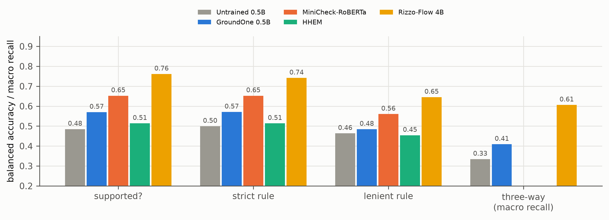
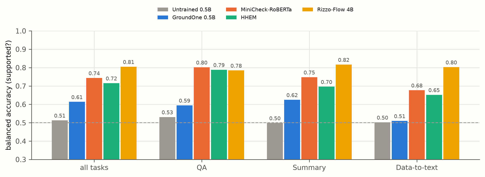
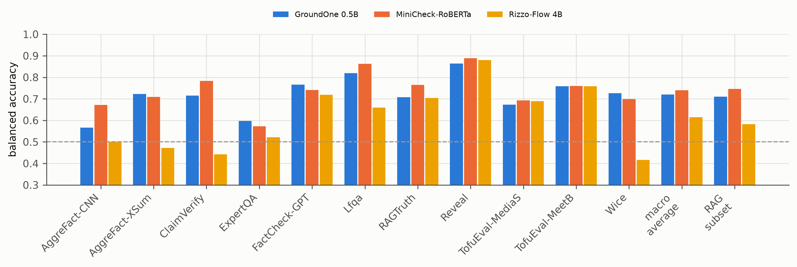

# Results figures (all systems evaluated so far)

Generated by `groundone figures`; regenerate after new results. Captions are drafts for the thesis.

## anli_questions_and_rules.png

ANLI test: the binary question, the two verification rules and the three-way question. Encoders produce one fixed score, evaluated against each rule's labels (no bar for three-way). Rizzo-Flow is measured on a 600-item subsample.

*Source: results/*/anli/metrics.json*

## ragtruth_supported_by_task.png

RAGTruth test, sentence level, binary question, by task (our span-derived labels, all sentences). Rizzo-Flow on a 200-answer subsample.

*Source: results/*/ragtruth/metrics.json*

## aggrefact_per_dataset.png

LLM-AggreFact test: balanced accuracy per sub-dataset at threshold 0.5, the 11-way macro average and the RAG-subset average (RAGTruth, LFQA, ClaimVerify, ExpertQA).

*Source: results/*/aggrefact/metrics.json*
