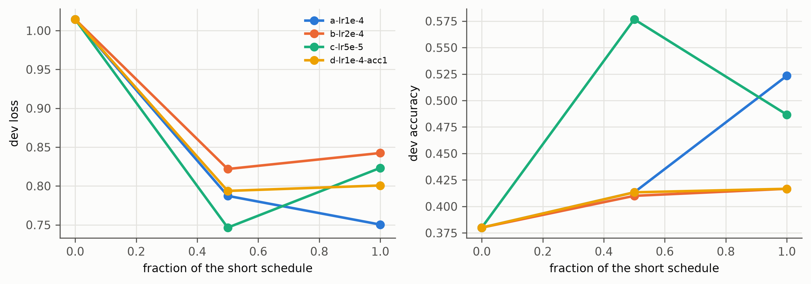

# Sweep figures (sweep-*)

Generated by `groundone figures`; regenerate after new results. Captions are drafts for the thesis.

## sweep_dev_curves.png

Short hyper-parameter sweep on the 0.5B (same ~2,200 examples in the same order per run, compressed schedule, fixed dev subset of 300): dev loss and accuracy. Step 0 is the untrained model.

*Source: models/sweep-*/train_log.jsonl*
