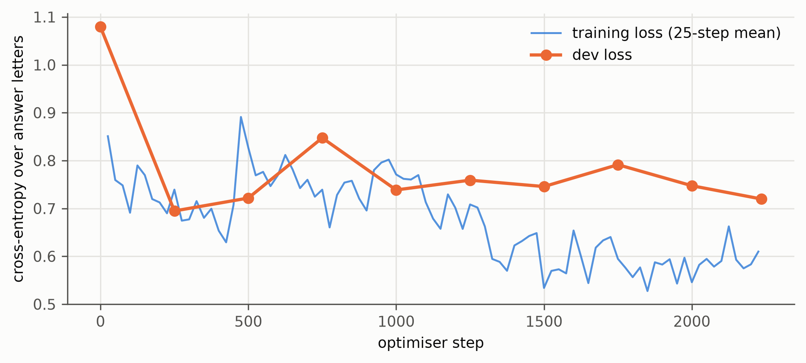
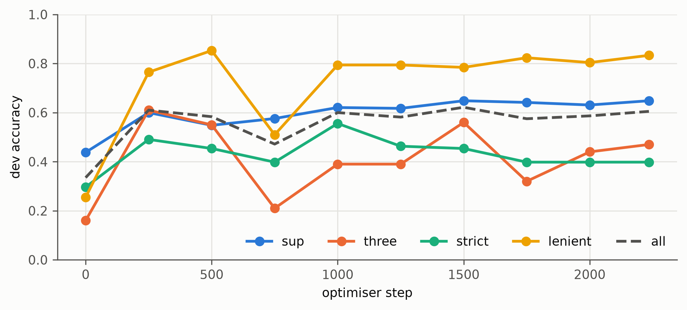
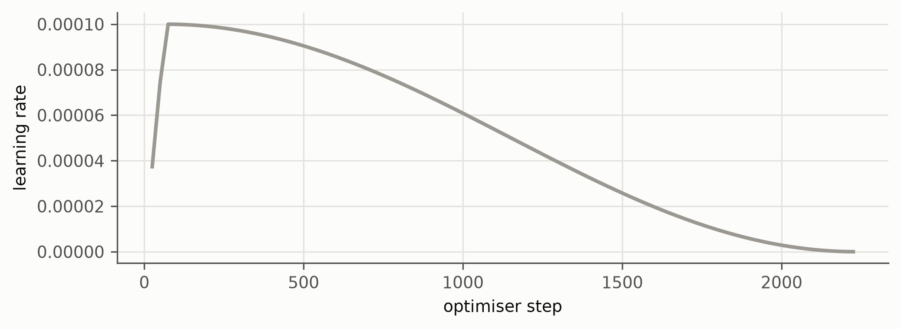

# Training figures: g1-05b-v1

Generated by `groundone figures`; regenerate after new results. Captions are drafts for the thesis.

## loss.png

Training and dev loss of run g1-05b-v1 (loss restricted to the allowed answer letters).

*Source: models/g1-05b-v1/train_log.jsonl*

## dev_accuracy_by_question.png

Dev accuracy per question type during training (run g1-05b-v1; fixed dev subset).

*Source: models/g1-05b-v1/train_log.jsonl*

## learning_rate.png

Learning-rate schedule (linear warm-up, cosine decay) of run g1-05b-v1.

*Source: models/g1-05b-v1/train_log.jsonl*
