# Benchmarks on the frozen test sets

Generated by `groundone figures`; regenerate after new results. Captions are drafts for the thesis.

## seed_runs_05b.png

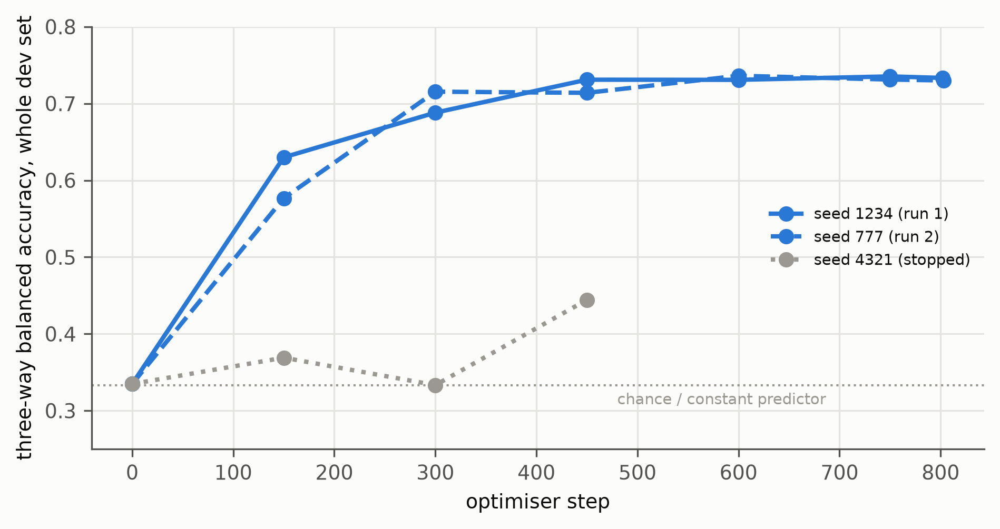

Development three-way balanced accuracy during training of the 0.5B with the same recipe and three seeds. Two runs converge to the same level; the third collapsed to a constant predictor after step 150 and was stopped at step ≈ 470.

*Source: models/g1-05b-{b1,s3,s2}/train_log.jsonl*

## energy_per_answer.png

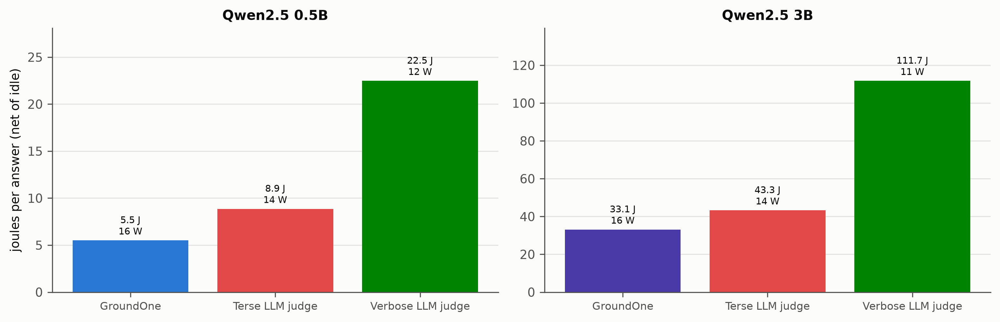

Energy per verified answer on 100 latency answers (powermetrics, CPU + GPU + Neural Engine, net of idle power), with the mean net power during the run. GroundOne uses the least energy, but its single long prefill draws more power than autoregressive decoding, so the energy advantage is smaller than the speed advantage.

*Source: results/energy-*/energy/metrics.json*

## equal_output_judges.png

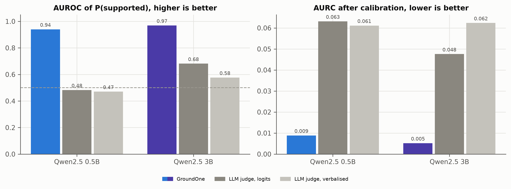

Equal-output comparison on the 200 latency answers: LLM judges of the same size asked for GroundOne's output (a label and three probabilities per sentence), with probabilities read from the logits of the generated letter or written in JSON; all systems calibrated on dev with the same map. Sentences with a valid verdict only.

*Source: results/{g1-*,judge-tlogit-*,judge-json-*}/latency/calibration.json*

## readout_vs_generation.png

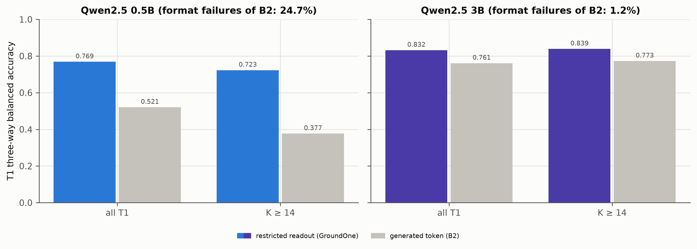

Control B2 on the full T1: with the same fine-tuned weights and the same forward pass, the verdict is either read from the three answer letters (GroundOne) or taken as the token that greedy generation would emit at the marker (failures counted as errors).

*Source: results/b2-*/t1/metrics.json*

## gain_decomposition.png

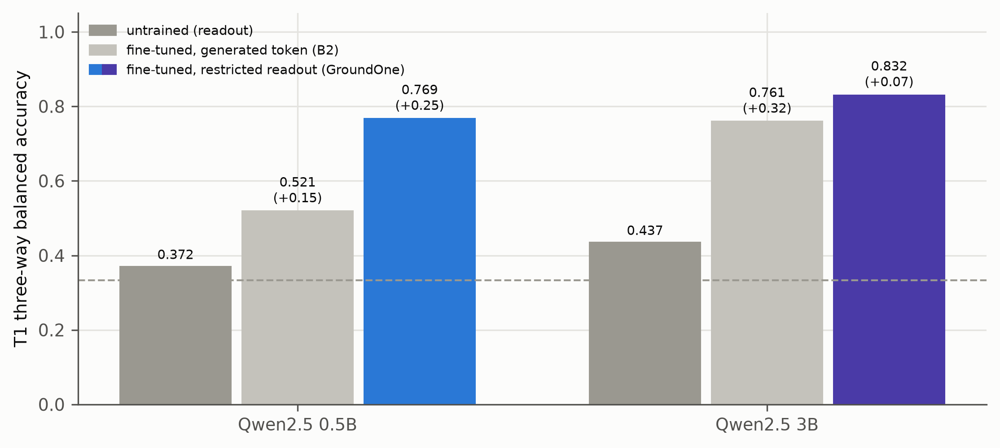

Where GroundOne's accuracy on T1 comes from: the same base model untrained (readout, design a), fine-tuned but deciding with the token it would generate (control B2, format failures counted as wrong), and fine-tuned with the restricted readout. In brackets, the gain over the previous step. The untrained 3B is evaluated on 600 answers. Dashed: chance.

*Source: results/{untrained,b2,g1}-*/t1/metrics.json*

## comparison_t1.png

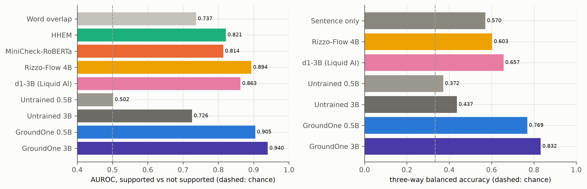

T1 RAGTruth test: AUROC of P(supported) for every system, and three-way balanced accuracy for systems with a three-way output. Word overlap and the sentence-only classifier never verify the sentence against the document. Rizzo-Flow and the untrained 3B are evaluated on subsamples (see metrics files).

*Source: results/*/t1/metrics.json*

## comparison_t3.png

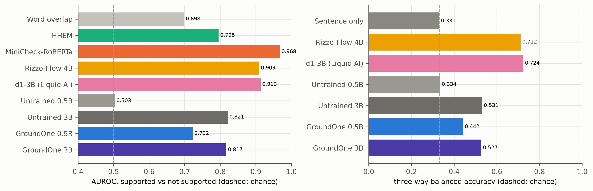

T3 VitaminC test: AUROC of P(supported) for every system, and three-way balanced accuracy for systems with a three-way output. Word overlap and the sentence-only classifier never verify the sentence against the document. Rizzo-Flow and the untrained 3B are evaluated on subsamples (see metrics files).

*Source: results/*/t3/metrics.json*

## t1_by_task.png

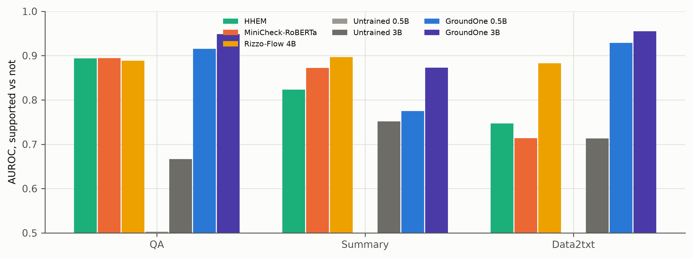

T1 (RAGTruth test) AUROC per task for each system.

*Source: results/*/t1/metrics.json*

## latency_vs_K.png

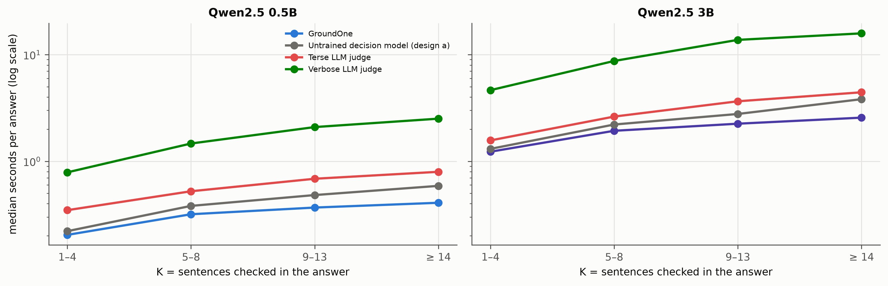

Latency per answer as a function of K on the same T1 answers (in-process MLX, one answer at a time, M4 16 GB). LLM judges write a verdict per sentence; the System One reads all K verdicts without generating text.

*Source: results/*/latency/metrics.json*

## judges_quality_failures.png

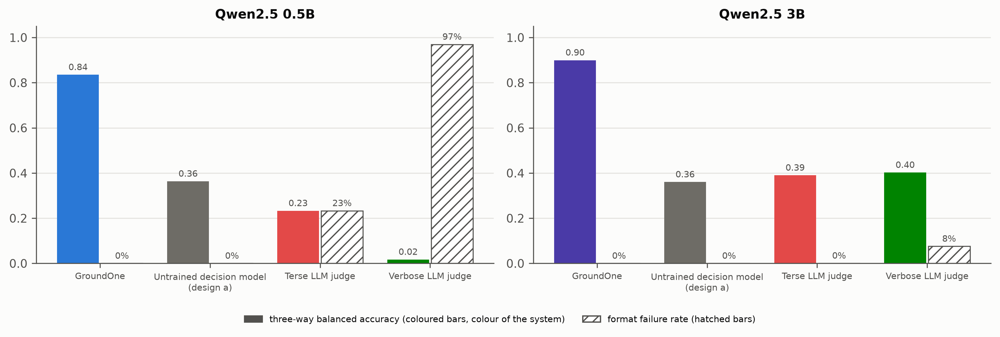

On the latency subset: three-way balanced accuracy (format failures counted as wrong) and share of sentences whose verdict could not be parsed. System One outputs are always valid.

*Source: results/*/latency/metrics.json*

## latency_split.png

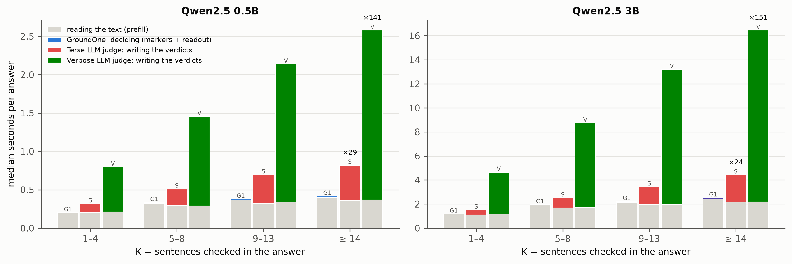

Time to verify one answer split into reading the document and the answer (the prefill, which every approach pays) and deciding: for GroundOne the marker tokens and the readout, for the LLM judges the decoding of the verdicts. Same 200 T1 answers as the latency runs, in-process MLX, medians per K band. The labels give, for K >= 14, how many times longer the LLM judge takes to decide than GroundOne.

*Source: results/decompose-*/decompose/metrics.json*

## prefill_composition.png

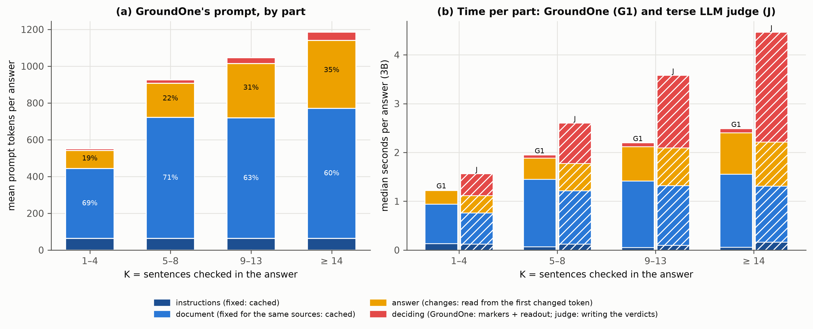

Composition of the prefill. (a) GroundOne's prompt on the 200 T1 latency answers, mean tokens by part per K band: the fixed instructions, the document, the answer and its markers (labels: share of the document and of answer + markers). (b) Measured time per part with the 3B, from the runs with nothing, the instructions or the instructions and the document in the KV cache (differences of the band medians, so each stack adds up to the median time without cache). The parts that stay the same across verifications of the same sources (blue) are the ones worth caching; the answer changes with every version.

*Source: results/decompose-3b/decompose/*.parquet*

## speedup_summary.png

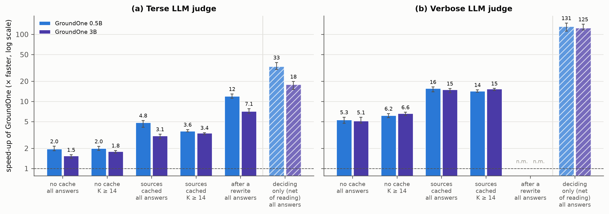

GroundOne's speed-up over the LLM judges in each situation, on the same 200 T1 answers (ratio of median times, 95 % bootstrap intervals). In every situation GroundOne and the judge have the same cache: the sources cached are the state after a read-ahead or an earlier verification; after a rewrite, the beginning of the answer is cached as well (verbose judge not measured, n.m.). The hatched bars, right of the line, exclude reading the text: the limit that the overall speed-up approaches as the reading shrinks.

*Source: results/decompose-*/decompose/metrics.json*
