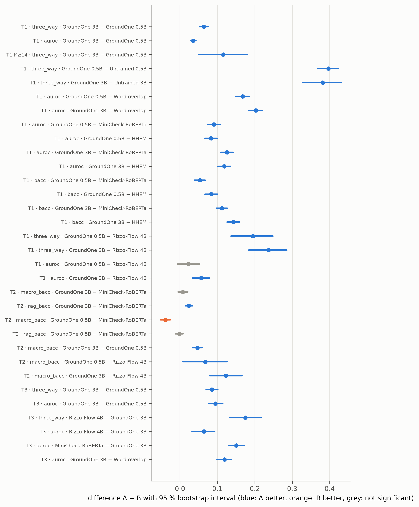

# Bootstrap intervals and paired tests

Generated by `groundone figures`; regenerate after new results. Captions are drafts for the thesis.

## paired_differences.png

Paired differences between systems on the frozen test sets with 95 % cluster-bootstrap intervals (resampling by source document / page; T2 within dataset). An interval that crosses zero means the difference is not significant at the 5 % level.

*Source: results/bootstrap/metrics.json*
