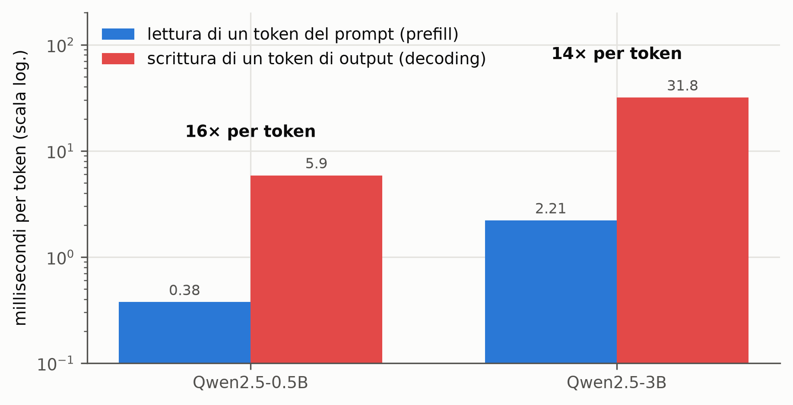
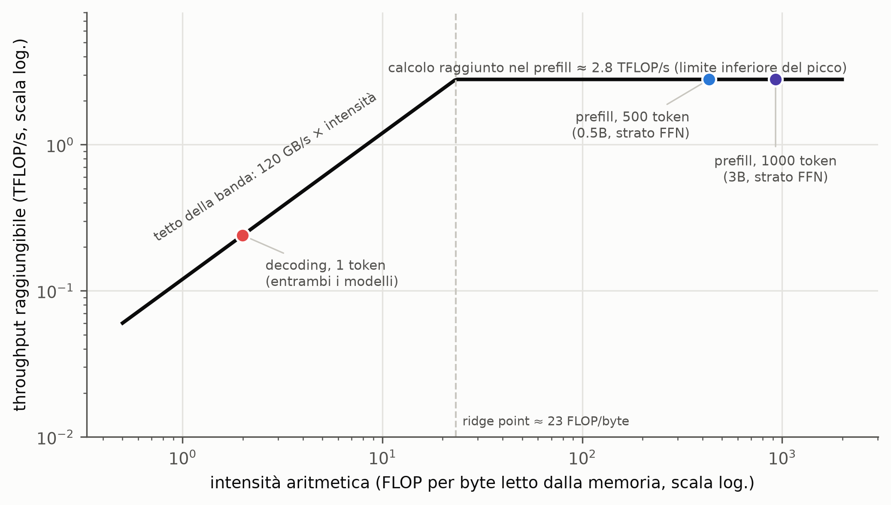
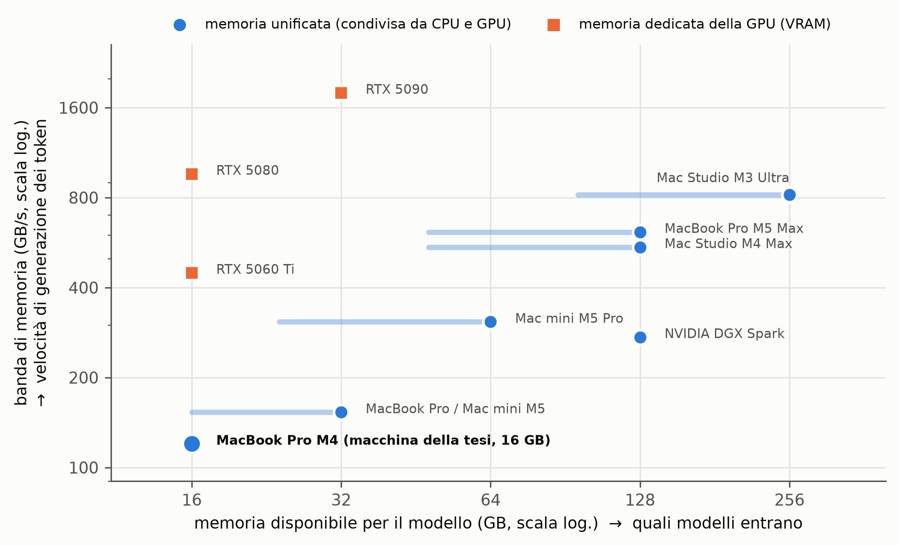
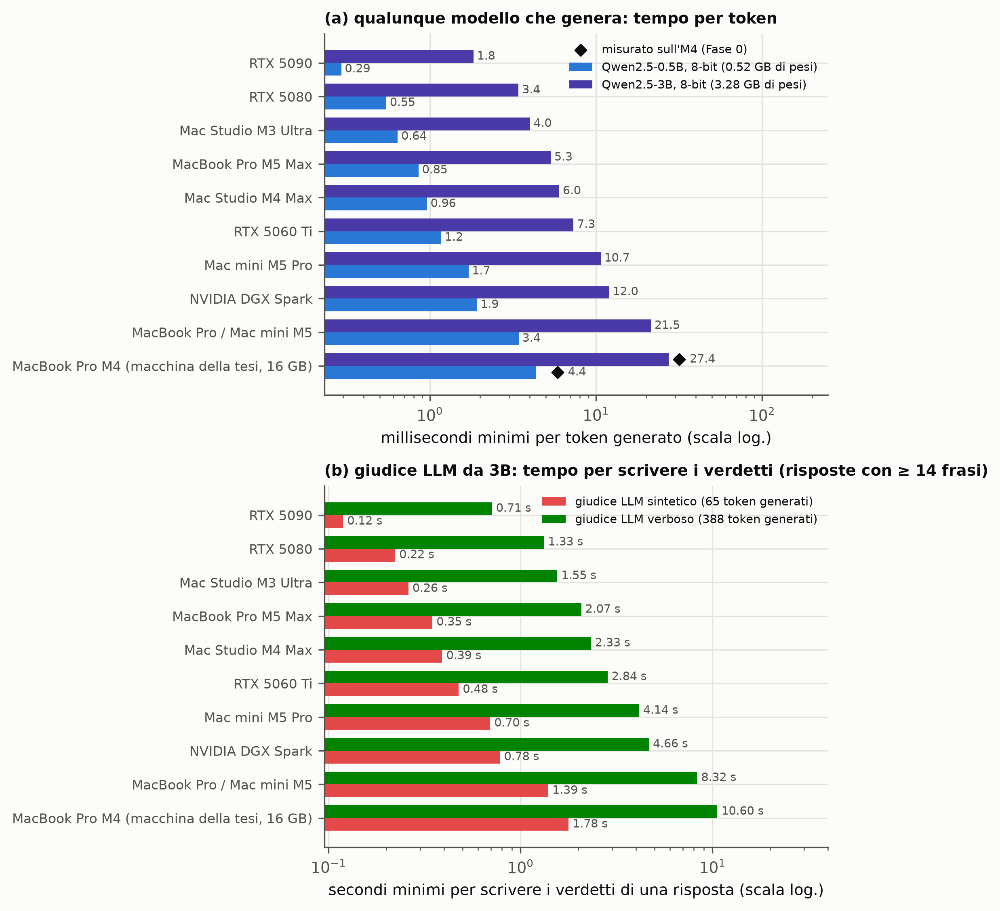
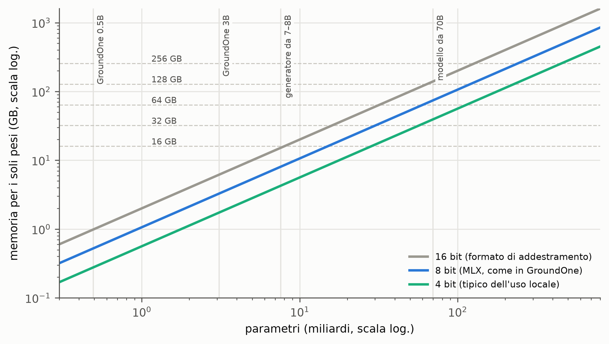
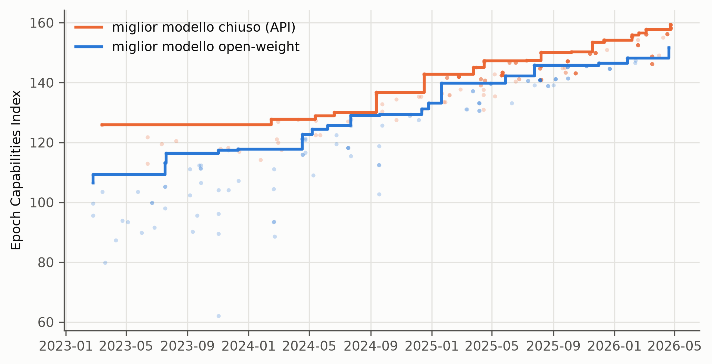
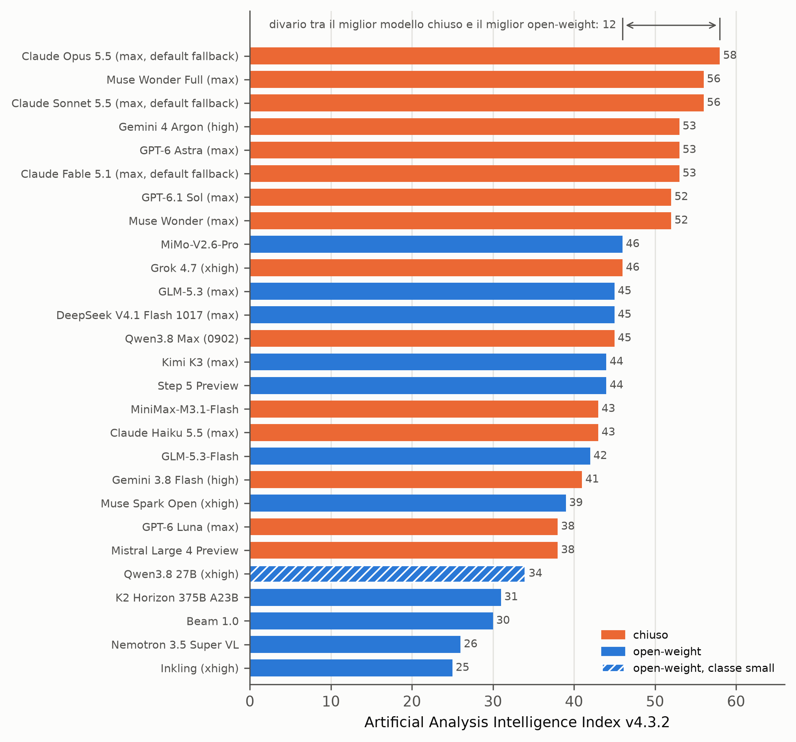

# Inferenza locale (Cap. 2)

Generated by `groundone figures`; regenerate after new results. Captions are drafts for the thesis.

## prefill_vs_decode_m4.png

Time per token when the model reads its input (prefill) and when it writes its output (decode), measured on the thesis machine (Apple M4, 16 GB, MLX 8-bit, batch 1). Prefill time is the median over 500-, 1,000- and 2,000-token contexts divided by the context length; decode time is the median per generated token. Writing a token costs about fifteen times more than reading one.

*Source: experiments/feasibility/results/04_speed_*.json (Phase 0)*

## roofline_m4.png

Roofline model of the thesis machine. The sloped roof is Apple's memory bandwidth (120 GB/s); Apple publishes no peak compute figure, so the flat roof is the throughput actually reached during prefill (2 FLOPs per parameter per token divided by the measured time per token), a lower bound of the peak. Generating one token reads every weight for about 2 FLOPs per byte and sits deep on the bandwidth roof; reading hundreds of tokens at once reuses each weight and reaches the compute roof. Intensities are computed for one feed-forward layer of Qwen2.5 with 8-bit weights and 16-bit activations; attention is ignored.

*Source: Williams et al. 2009 (model) + Phase 0 timings + Qwen2.5 layer shapes*

## hardware_landscape.png

Local inference hardware on the two axes that decide what can run: memory capacity (which models fit) and memory bandwidth (how fast tokens can be generated). Discrete GPUs have the highest bandwidth but at most 32 GB; unified-memory machines trade bandwidth for capacity. Values are the vendors' published specifications (Apple, NVIDIA spec pages, accessed 2026-10-11): the marker is the largest memory configuration at that bandwidth, the shaded bar the range of memory sizes offered; the thesis machine is shown at its actual 16 GB.

*Source: figures/locality.py HARDWARE (vendor spec pages in Vault/raw/local_inference)*

## decode_cost_by_hardware.png

Lower bounds on the cost of generating text on each class of local hardware, computed as weight bytes divided by the vendor's memory bandwidth (batch 1, KV cache ignored). (a) Time per generated token for the two GroundOne base models in 8-bit; diamonds: decode time measured on the thesis machine, about 75–85 % of the bound. (b) Minimum time a 3B generative judge spends only on writing its verdicts for an answer of 14 or more sentences (median generated tokens of the latency protocol). A System One generates no token, so both costs are zero for it on every machine.

*Source: figures/locality.py (arithmetic on vendor specs) + Phase 0 + results/judge-{terse,verbose}-3b/latency*

## memory_fit.png

Memory needed for the weights of a model as a function of its size and precision (parameters × bits per weight; the 8- and 4-bit lines include half a bit of per-group scales). Dashed lines mark common memory sizes of local hardware. The KV cache, activations, the operating system and any other model running at the same time come on top, so a 16 GB laptop holds a 7–8B generator in 4 bits and a small verifier, but not much more.

*Source: figures/locality.py (arithmetic)*

## open_closed_gap.png

Capability of the best closed and the best open-weight model over time, on Epoch AI's aggregate Epoch Capabilities Index (dots: individual models; lines: best so far). Open-weight models trail the closed frontier by a few months (about four on average in January–May 2026, according to Epoch AI).

*Source: Epoch AI, open vs closed capability gap (data table, accessed 2026-10-11)*

## aa_intelligence_snapshot.png

Artificial Analysis Intelligence Index on 2026-10-20 (v4.3.2, 10 evaluations), redrawn from the published chart; open-weight status from the leaderboard data. Best closed model 58, best open-weight model 46.

*Source: Artificial Analysis leaderboard, accessed 2026-10-20*
