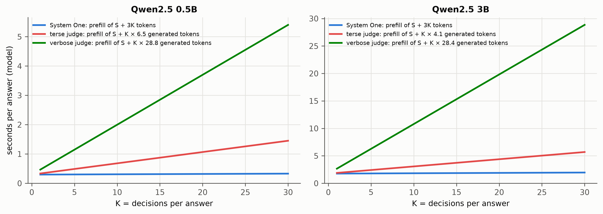

# Method (Ch. 4)

Generated by `groundone figures`; regenerate after new results. Captions are drafts for the thesis.

## cost_model.png

Analytic cost of verifying one answer of S = 800 tokens as a function of K, from measured constants only: prefill and decode time per token on the M4 and the mean number of tokens each judge generates per verdict on the latency subset (mean K = 8.7). Not a measurement; the measured latencies are in Ch. 7.

*Source: Phase 0 timings + results/*/latency/metrics.json*
