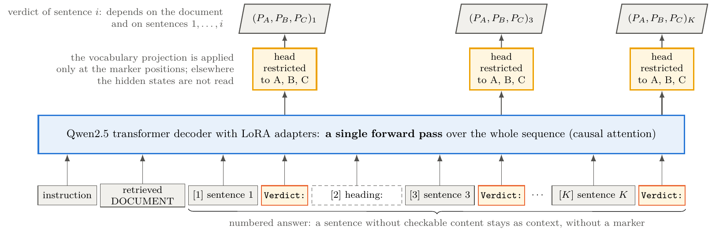
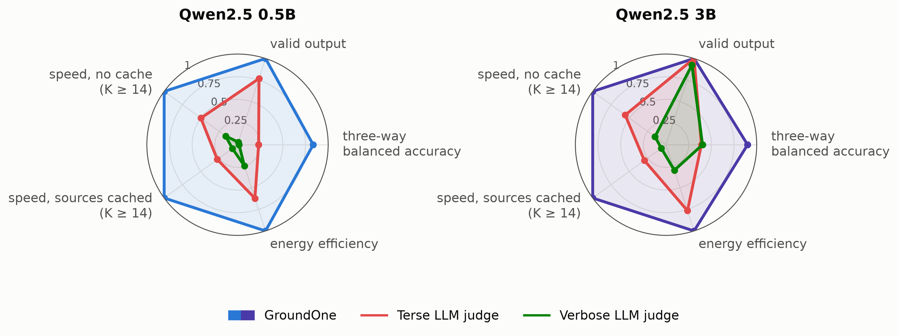
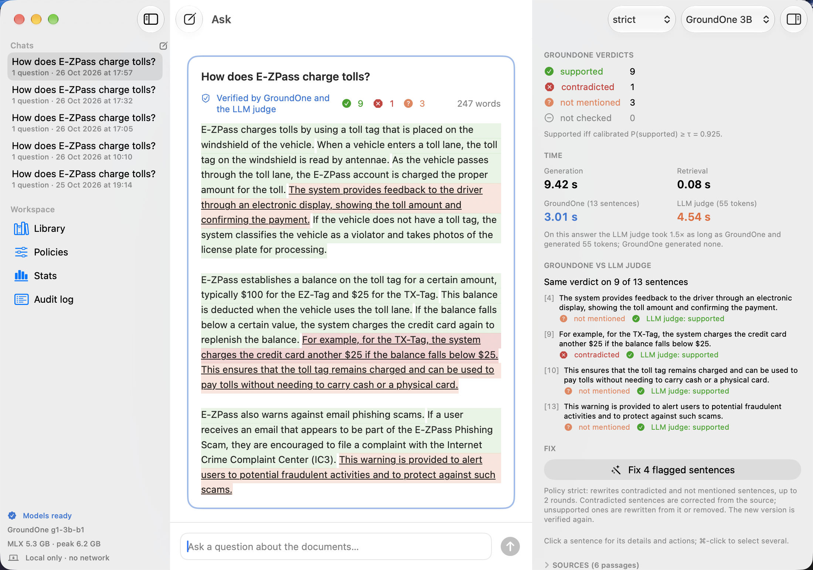
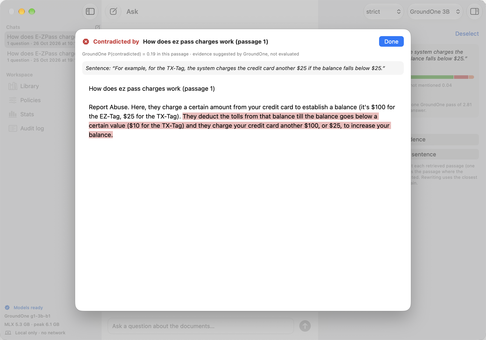
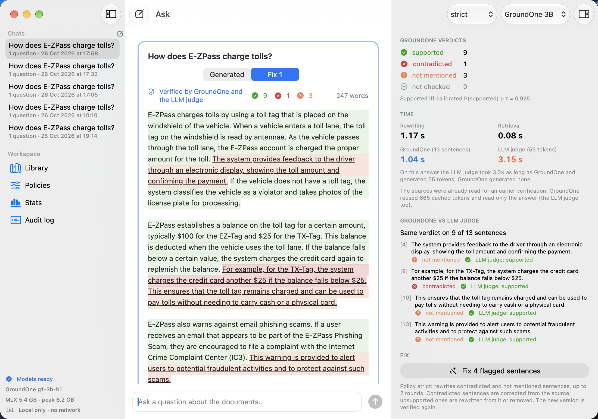

<div align="center">


# GroundOne

**A specialist decision model for groundedness verification in local retrieval-augmented generation**

*Fine-tuning compact language models as calibrated single-forward-pass verifiers on Apple Silicon*

[](Thesis/thesis.pdf)
[](Thesis/thesis.pdf)
[](Project/GroundOne)
[](https://github.com/ml-explore/mlx)
[](Project/demo/GroundOne%20Studio)
[](Project/GroundOne/configs)
[](Thesis)
[](#groundone-studio)

[Overview](#overview) · [How it works](#how-it-works) · [Results](#results) · [GroundOne Studio](#groundone-studio) · [Quick start](#quick-start) · [Repository](#repository-layout) · [Citation](#citation)

</div>

---

## Overview

A RAG system answers from retrieved documents, but nothing guarantees that every sentence of the answer is actually
backed by them. **GroundOne** checks this, sentence by sentence: for each sentence of an answer it decides whether the
retrieved document **supports** it, **contradicts** it, or **does not mention** it.

It does so without generating a single token. A compact language model (Qwen2.5 0.5B or 3B, fine-tuned with LoRA)
reads the document and the whole answer in **one forward pass** and returns three calibrated probabilities per sentence,
read from the logits of three answer letters. Everything runs locally on a 16 GB Apple Silicon laptop: no API, no
network, no data leaving the device.

|                        |                                                                                     |
| ---------------------- | ----------------------------------------------------------------------------------- |
| 🎯 **Task**            | Sentence-level groundedness: supported · contradicted · not mentioned                |
| ⚡ **Readout**         | One forward pass per answer, a verdict at every sentence marker, 0 generated tokens  |
| 📐 **Output**          | Three calibrated probabilities per sentence, one served decision threshold           |
| 🧠 **Models**          | Qwen2.5-0.5B / 3B-Instruct, MLX 8-bit, LoRA on all linear layers                     |
| 💻 **Hardware**        | Apple Silicon, 16 GB unified memory, fully on-device                                 |
| 🧪 **Evaluation**      | Frozen test sets: T1 RAGTruth, T2 LLM-AggreFact, T3 VitaminC; cluster-bootstrap CIs  |

## How it works

The answer is split into sentences and a `Verdict:` marker is written after every sentence with checkable content. The
model reads instruction, document and answer once; the output head is applied only at the markers and restricted to the
letters A, B and C, so the K verdicts of an answer cost a single pass. Training uses a class-weighted cross-entropy over
the three letters at every marker; the prompt is never supervised. Temperature and per-class bias are then fitted on the
dev set, together with the threshold on P(supported) used by the served decision.

<p align="center">
  
</p>

## Results

Accuracy on the three frozen test sets (three-way balanced accuracy and AUROC of P(supported); macro balanced accuracy on
T2, as in the LLM-AggreFact leaderboard).

| System                | T1 three-way | T1 AUROC  | T2 macro | T3 three-way | T3 AUROC  |
| --------------------- | :----------: | :-------: | :------: | :----------: | :-------: |
| **GroundOne 0.5B**    | 0.769        | 0.905     | 70.1     | 0.442        | 0.722     |
| **GroundOne 3B**      | **0.832**    | **0.940** | 74.8     | 0.527        | 0.817     |
| MiniCheck-RoBERTa     | –            | 0.814     | 74.0     | –            | **0.968** |
| HHEM-2.1-open         | –            | 0.821     | –        | –            | 0.795     |
| Rizzo-Flow 4B †       | 0.603        | 0.894     | 61.5     | 0.712        | 0.909     |
| d1-3B                 | 0.657        | 0.863     | 75.7 †   | **0.724**    | 0.913     |

<sub>† on a subsample of the test set. T2 differences between the top systems are not significant; on T3 (Wikipedia
revisions, out of domain) the encoders and the general-purpose decision models are ahead.</sub>

Against an LLM judge of the **same size on the same machine** (200 T1 answers, Apple M4, 16 GB):

| Model | System         | Bal. acc. | Format failures | s/answer, K ≥ 14 | s/answer, sources cached | J/answer |
| ----- | -------------- | :-------: | :-------------: | :--------------: | :----------------------: | :------: |
| 0.5B  | **GroundOne**  | **0.835** | **0 %**         | **0.42**         | **0.17**                 | **5.5**  |
|       | Terse judge    | 0.233     | 23 %            | 0.83             | 0.61                     | 8.9      |
| 3B    | **GroundOne**  | **0.900** | **0 %**         | **2.49**         | **0.93**                 | **33.1** |
|       | Terse judge    | 0.390     | 0.1 %           | 4.47             | 3.15                     | 43.3     |

- In the least favourable case (long answers, nothing cached) GroundOne is **1.8–2× faster** than the terse judge and
  about 6× faster than a verbose one; after a rewrite, with the sources already read, **7–12×** over all answers.
- The gain comes from specialisation and model size, one-pass multi-sentence scoring, rationale-free output and
  calibration: with the same weights, generating a single letter has the same latency as the readout, but the restricted
  readout is 0.07 to 0.25 more accurate.

<p align="center">
  
</p>

## GroundOne Studio

A native macOS app (SwiftUI + MLX Swift) built around GroundOne, with every model in the same process: it retrieves
from a local library, generates an answer, verifies it sentence by sentence, shows the evidence passage for each
sentence and rewrites the flagged sentences according to a policy, then verifies the new version again. Nothing leaves
the device.

<p align="center">
  
</p>

<table>
  <tr>
    <td></td>
    <td></td>
  </tr>
  <tr>
    <td align="center"><sub>Evidence passage for a sentence</sub></td>
    <td align="center"><sub>The answer after a targeted rewrite</sub></td>
  </tr>
</table>

The core of the app follows a ports-and-adapters design: the session logic knows only abstract ports (retriever,
generator, verifier, LLM judge, attributor), the MLX engines implement them, and the core is tested with fake,
deterministic engines.

## Quick start

Requirements: macOS on Apple Silicon, a native arm64 Python 3.12, [uv](https://github.com/astral-sh/uv).

```bash
cd Project/GroundOne
uv venv --python 3.12 .venv
uv pip install --python .venv/bin/python -e ".[test]"

pytest -q -m "not model"                                   # fast tests, fake backend, no weights
groundone data build && groundone data check               # dataset + leakage check
groundone train --config train_0.5b.yaml                   # LoRA fine-tuning (run long jobs under `groundone guard`)
groundone calibrate-b --adapter <run>/best --name <name>   # temperature, bias and served threshold on dev
groundone test --suite t1 --adapter <run>/best --name <name>
groundone serve --adapter <run>/best                       # HTTP API on 127.0.0.1:8019
```

Full CLI reference and the HTTP API (`/v1/verify`, `/v1/prefetch`, compatible `/v1/systemone`) are in
[`Project/GroundOne/README.md`](Project/GroundOne/README.md). Datasets are downloaded with
[`Project/data/download.py`](Project/data/download.py) (LLM-AggreFact is gated on Hugging Face). Model weights, adapters
and processed data are not versioned.

## Repository layout

```
.
├── Project/                  experiment workspace
│   ├── GroundOne/            Python package: dataset, training, calibration, evaluation, baselines, CLI, HTTP API, tests
│   ├── demo/                 GroundOne Studio, the native macOS app (SwiftUI + MLX Swift)
│   ├── data/                 download script, manifests, data card and check reports
│   ├── experiments/          feasibility study and exploratory data analysis
│   ├── outputs/              figures and result summaries (metrics.json)
│   ├── jobs/                 job queues run under the memory guard
│   └── docs/                 implementation plan, decision log, dataset plan, tracker
├── Thesis/                   LaTeX source (toptesi) and the compiled thesis.pdf
└── README.md
```

## Citation

```bibtex
@mastersthesis{dedominicis2026groundone,
  author = {De Dominicis, Francesco Pio},
  title  = {{GroundOne}: A Specialist Decision Model for Groundedness Verification in Local
            Retrieval-Augmented Generation},
  school = {Politecnico di Torino},
  type   = {Master's thesis, Computer Engineering},
  year   = {2026},
  note   = {Supervisor: Prof. Paolo Garza}
}
```

<div align="center">
<sub>Master's Degree in Computer Engineering · Politecnico di Torino · A.Y. 2025/2026<br>
Francesco Pio De Dominicis · Supervisor: Prof. Paolo Garza</sub>
</div>
